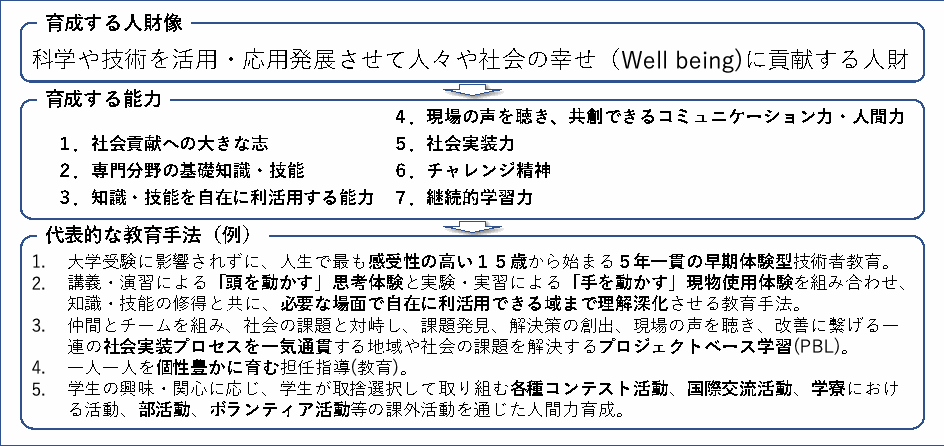

# 図1 国立高専が育成する人財像、能力と代表的な教育手法



## 図の中の文字（原文。PDF の文字層から抽出）

```text
科学や技術を活用・応用発展させて人々や社会の幸せ（Well being)に貢献する人財
育成する人財像
育成する能力
１．社会貢献への大きな志
２．専門分野の基礎知識・技能
３．知識・技能を自在に利活用する能力
４．現場の声を聴き、共創できるコミュニケーション力・人間力
５．社会実装力
６．チャレンジ精神
７．継続的学習力
1.大学受験に影響されずに、人生で最も感受性の高い１５歳から始まる５年一貫の早期体験型技術者教育。
2.講義・演習による「頭を動かす」思考体験と実験・実習による「手を動かす」現物使用体験を組み合わせ、
知識・技能の修得と共に、必要な場面で自在に利活用できる域まで理解深化させる教育手法。
3.仲間とチームを組み、社会の課題と対峙し、課題発見、解決策の創出、現場の声を聴き、改善に繋げる一
連の社会実装プロセスを一気通貫する地域や社会の課題を解決するプロジェクトベース学習(PBL)。
4.一人一人を個性豊かに育む担任指導(教育)。
5.学生の興味・関心に応じ、学生が取捨選択して取り組む各種コンテスト活動、国際交流活動、学寮におけ
る活動、部活動、ボランティア活動等の課外活動を通じた人間力育成。
代表的な教育手法（例）
```

## 書き起こし（原文ではない）

「育成する人財像」「育成する能力」「代表的な教育手法（例）」の見出しを持つ3つの枠が上から下へ並び、枠と枠の間に下向きの白抜き矢印がある。最上段の枠には、育成する人財像として「科学や技術を活用・応用発展させて人々や社会の幸せ（Well being)に貢献する人財」が大きく書かれている。中段の枠には「１．社会貢献への大きな志」から「７．継続的学習力」までの7項目が、左列に1〜3、右列に4〜7の2列で並ぶ。最下段の枠には1〜5の番号付きの教育手法が文章で列挙され、「プロジェクトベース学習」などの語句が太字で強調されている。
