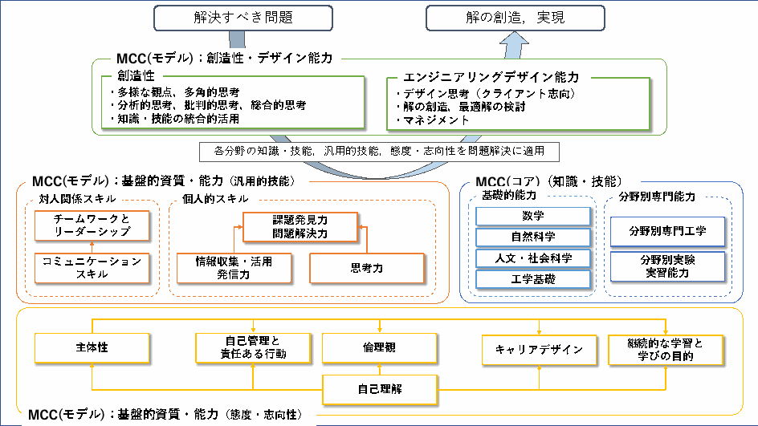

# 図2 MCC到達目標の全体構成



## 図の中の文字（原文。PDF の文字層から抽出）

```text
MCC(コア)（知識・技能）
基礎的能力数学
自然科学
人文・社会科学
工学基礎
分野別専門能力
分野別専門工学
分野別実験
実習能力
MCC(モデル)：創造性・デザイン能力
・多様な観点，多角的思考
・分析的思考，批判的思考，総合的思考
・知識・技能の統合的活用
創造性
・デザイン思考（クライアント志向）
・解の創造，最適解の検討
・マネジメント
エンジニアリングデザイン能力
解決すべき問題
解の創造，実現
主体性
自己理解
自己管理と
責任ある行動
倫理観
キャリアデザイン
継続的な学習と
学びの目的
MCC(モデル)：基盤的資質・能力（態度・志向性）
コミュニケーション
スキル
チームワークと
リーダーシップ
対人関係スキル
MCC(モデル)：基盤的資質・能力（汎用的技能）
個人的スキル
情報収集・活用
発信力
思考力
課題発見力
問題解決力
各分野の知識・技能，汎用的技能，態度・志向性を問題解決に適用
```

## 書き起こし（原文ではない）

上段に緑の枠「MCC(モデル)：創造性・デザイン能力」があり、その中に「創造性」と「エンジニアリングデザイン能力」の2つの箱が左右に並び、それぞれ箇条書きの項目を持つ。中段は、左にオレンジの枠「MCC(モデル)：基盤的資質・能力（汎用的技能）」（「対人関係スキル」と「個人的スキル」の点線の区画を含む）、右に青い枠「MCC(コア)（知識・技能）」（「基礎的能力」の4項目と「分野別専門能力」の2項目を含む）があり、下段には黄色の枠「MCC(モデル)：基盤的資質・能力（態度・志向性）」が横に広がる。図の最上部には「解決すべき問題」と「解の創造，実現」の2つの箱があり、左上の「解決すべき問題」の側から、中央の帯「各分野の知識・技能，汎用的技能，態度・志向性を問題解決に適用」の下側を通って弧を描く太い矢印が、右上の「解の創造，実現」へ上向きに伸びている。汎用的技能の枠内では、「コミュニケーションスキル」から「チームワークとリーダーシップ」へ、「情報収集・活用発信力」と「思考力」から「課題発見力」「問題解決力」の箱へ矢印が向かう。態度・志向性の枠内では、下中央の「自己理解」から、上に並ぶ「主体性」「自己管理と責任ある行動」「倫理観」「キャリアデザイン」「継続的な学習と学びの目的」の5つへ黄色の矢印が伸びている。
