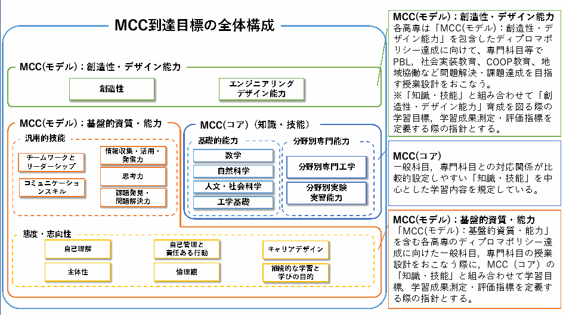

# 図3 MCC(コア)とMCC(モデル)



## 図の中の文字（原文。PDF の文字層から抽出）

```text
MCC(モデル)：創造性・デザイン能力
MCC(モデル)：基盤的資質・能力
MCC(コア)（知識・技能）
基礎的能力
数学
自然科学
人文・社会科学
工学基礎
分野別専門能力
分野別専門工学
分野別実験
実習能力
汎用的技能
コミュニケーショ
ンスキル
チームワークと
リーダーシップ
情報収集・活用・
発信力
思考力
課題発見・
問題解決力
態度・志向性自己理解
主体性
自己管理と
責任ある行動
倫理観
キャリアデザイン
継続的な学習と
学びの目的
創造性
エンジニアリング
デザイン能力
MCC(コア)
一般科目，専門科目との対応関係が比
較的設定しやすい「知識・技能」を中
心とした学習内容を規定している。
MCC(モデル)：創造性・デザイン能力
各高専は「MCC(モデル)：創造性・デ
ザイン能力」を包含したディプロマポ
リシー達成に向けて、専門科目等で
PBL，社会実装教育、COOP教育、地
域協働など問題解決・課題達成を目指
す授業設計をおこなう。
※「知識・技能」と組み合わせて「創
造性・デザイン能力」育成を図る際の
学習目標，学習成果測定・評価指標を
定義する際の指針とする。
MCC(モデル)：基盤的資質・能力
「MCC(モデル)：基盤的資質・能力」
を含む各高専のディプロマポリシー達
成に向けた一般科目，専門科目の授業
設計をおこなう際に，MCC（コア）の
「知識・技能」と組み合わせて学習目
標，学習成果測定・評価指標を定義す
る際の指針とする。
MCC到達目標の全体構成
```

## 書き起こし（原文ではない）

左側に「MCC到達目標の全体構成」と題した大きな枠があり、その中に、上部の緑の枠「MCC(モデル)：創造性・デザイン能力」（「創造性」「エンジニアリングデザイン能力」）、左下のオレンジの枠「MCC(モデル)：基盤的資質・能力」、右側の青い枠「MCC(コア)（知識・技能）」が配置されている。オレンジの枠は「汎用的技能」と「態度・志向性」の2つの点線の区画に分かれ、「態度・志向性」の区画は青い枠の下まで横に広がっている。青い枠は「基礎的能力」（「数学」「自然科学」「人文・社会科学」「工学基礎」）と「分野別専門能力」（「分野別専門工学」「分野別実験実習能力」）の2つの点線の区画からなる。図の右側には緑・青・オレンジの枠線を持つ3つの説明の箱が上から並び、それぞれ線で左側の同じ色の枠に結ばれて、各区分の位置づけを文章で説明している。
