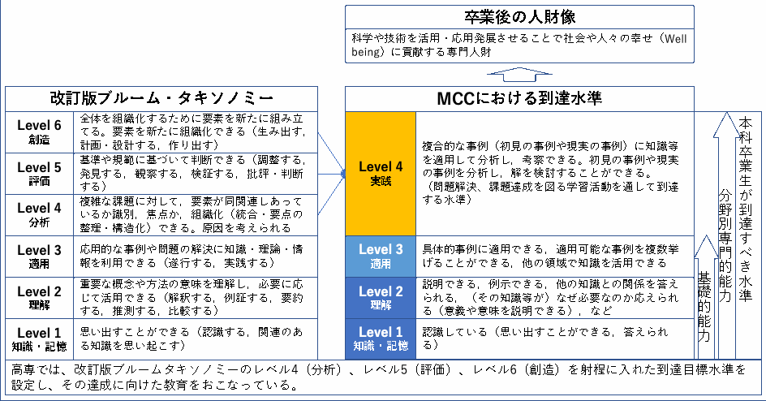

# 図4 MCC(コア)における到達水準の考え方



## 図の中の文字（原文。PDF の文字層から抽出）

```text
Level 1
知識・記憶
改訂版ブルーム・タキソノミー
Level 2
理解
Level 3
適用
Level 4
分析
Level 5
評価
Level 6
創造
思い出すことができる（認識する，関連のあ
る知識を思い起こす）
重要な概念や方法の意味を理解し，必要に応
じて活用できる（解釈する，例証する，要約
する，推測する，比較する）
応用的な事例や問題の解決に知識・理論・情
報を利用できる（遂行する，実践する）
複雑な課題に対して，要素が同関連しあって
いるか識別，焦点か，組織化（統合・要点の
整理・構造化）できる。原因を考えられる
基準や規範に基づいて判断できる（調整する，
発見する，観察する，検証する，批評・判断
する）
全体を組織化するために要素を新たに組み立
てる。要素を新たに組織化できる（生み出す，
計画・設計する，作り出す）
Level 1
知識・記憶
MCCにおける到達水準
Level 2
理解
Level 3
適用
Level 4
実践
認識している（思い出すことができる，答えられ
る）
説明できる，例示できる，他の知識との関係を答え
られる，（その知識等が）なぜ必要なのか応えられ
る（意義や意味を説明できる），など
具体的事例に適用できる，適用可能な事例を複数挙
げることができる，他の領域で知識を活用できる
複合的な事例（初見の事例や現実の事例）に知識等
を適用して分析し，考察できる。初見の事例や現実
の事例を分析し，解を検討することができる。
（問題解決、課題達成を図る学習活動を通して到達
する水準）
本科卒業生が到達すべき水準
卒業後の人財像
基礎的能力
分野別専門的能力
高専では、改訂版ブルームタキソノミーのレベル4（分析）、レベル5（評価）、レベル6（創造）を射程に入れた到達目標水準を
設定し、その達成に向けた教育をおこなっている。
科学や技術を活用・応用発展させることで社会や人々の幸せ（Well
being）に貢献する専門人財
```

## 書き起こし（原文ではない）

左に「改訂版ブルーム・タキソノミー」の表があり、「Level 1 知識・記憶」から「Level 6 創造」までが下から上へ6段に積まれ、各段に説明文が付いている。中央には「MCCにおける到達水準」の表があり、「Level 1 知識・記憶」「Level 2 理解」「Level 3 適用」「Level 4 実践」が下から上へ4段に積まれ、Level 4 は黄色、Level 1〜3 は青系の色で塗られている。左の表の Level 4〜6 の3段から引かれた線が、中央の表の Level 4 に集まっている。中央の表の上には上向きの白抜き矢印があり、その先に「卒業後の人財像」の箱がある。中央の表の右側には上向きの矢印が3本あり、それぞれ「基礎的能力」「分野別専門的能力」「本科卒業生が到達すべき水準」と書かれ、最も短い「基礎的能力」は Level 3 の高さまで、他の2本は Level 4 の高さまで達している。最下部には、高専が改訂版ブルームタキソノミーのレベル4〜6を射程に入れた到達目標水準を設定していることを述べる注記がある。
