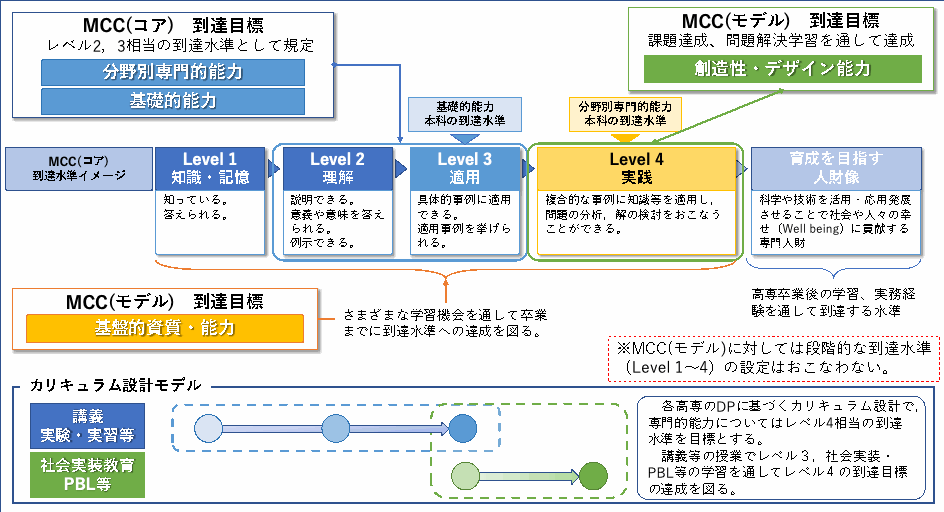

# 図5 MCCにおける到達水準とカリキュラム設計の関係



## 図の中の文字（原文。PDF の文字層から抽出）

```text
分野別専門的能力
本科の到達水準
MCC(コア)
到達水準イメージ
Level 1
知識・記憶
知っている。
答えられる。
Level 2
理解
説明できる。
意義や意味を答え
られる。
例示できる。
Level 3
適用
具体的事例に適用
できる。
適用事例を挙げら
れる。
Level 4
実践
複合的な事例に知識等を適用し，
問題の分析，解の検討をおこなう
ことができる。
育成を目指す
人財像
科学や技術を活用・応用発展
させることで社会や人々の幸
せ（Well being）に貢献する
専門人財
MCC(コア)到達目標
レベル2，3相当の到達水準として規定
基礎的能力
分野別専門的能力
MCC(モデル)到達目標
課題達成、問題解決学習を通して達成
創造性・デザイン能力
講義
実験・実習等
社会実装教育
PBL等
各高専のDPに基づくカリキュラム設計で，
専門的能力についてはレベル4相当の到達
水準を目標とする。
講義等の授業でレベル３，社会実装・
PBL等の学習を通してレベル４の到達目標
の達成を図る。
基礎的能力
本科の到達水準
カリキュラム設計モデル
MCC(モデル)到達目標
基盤的資質・能力
※MCC(モデル)に対しては段階的な到達水準
（Level1～4）の設定はおこなわない。
さまざまな学習機会を通して卒業
までに到達水準への達成を図る。
高専卒業後の学習、実務経
験を通して到達する水準
```

## 書き起こし（原文ではない）

中段に横一列で、「MCC(コア)到達水準イメージ」のラベル、「Level 1 知識・記憶」から「Level 4 実践」までの4つの箱、右端の「育成を目指す人財像」の箱が並ぶ。Level 2 と Level 3 は青い枠で囲まれて上の「基礎的能力 本科の到達水準」のラベルから下向きの矢印が指し、Level 4 は緑の枠で囲まれて「分野別専門的能力 本科の到達水準」のラベルから下向きの矢印が指している。左上の「MCC(コア)到達目標」の箱（「レベル2，3相当の到達水準として規定」、「分野別専門的能力」「基礎的能力」）は青い線で青い枠に、右上の「MCC(モデル)到達目標」の箱（「創造性・デザイン能力」）は緑の線で緑の枠に結ばれている。Level 1〜4 の下にはオレンジの波括弧があり、その下に「MCC(モデル)到達目標」（「基盤的資質・能力」）の箱と「さまざまな学習機会を通して卒業までに到達水準への達成を図る。」の文が置かれ、人財像の箱の下には「高専卒業後の学習、実務経験を通して到達する水準」と書かれた括弧がある。最下部の「カリキュラム設計モデル」では、「講義 実験・実習等」（青）と「社会実装教育 PBL等」（緑）の凡例の右に、青の点線の区画で3つの青い円が矢印でつながり、緑の点線の区画が3つ目の青い円と、矢印でつながった2つの緑の円を囲んでいる。右側には赤い点線の枠の注記と、カリキュラム設計について説明する箱がある。
