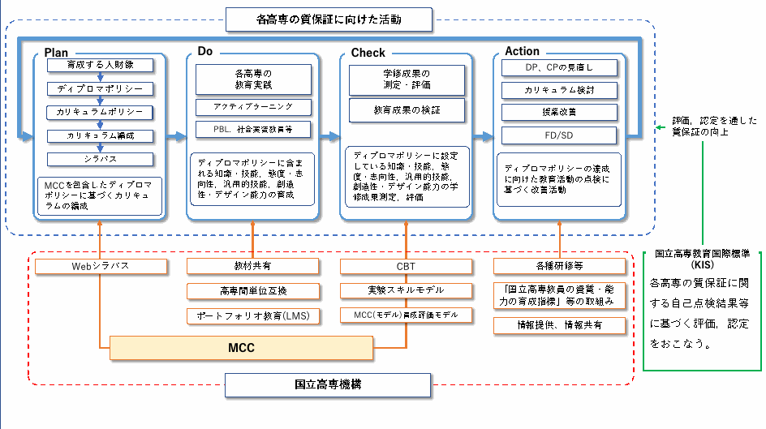

# 図6 各高専の質保証PDCAサイクルとMCC及び高専機構の取組み



## 図の中の文字（原文。PDF の文字層から抽出）

```text
Plan
Do
Check
Action
MCC
ディプロマポリシー
カリキュラムポリシー
カリキュラム編成
Webシラバス
学修成果の
測定・評価
教育成果の検証
シラバス
CBT
実験スキルモデル
MCC(モデル)育成評価モデル
教材共有
高専間単位互換
カリキュラム検討
各高専の
教育実践
アクティブラーニング
PBL，社会実装教育等
授業改善
FD/SD
ディプロマポリシーに含ま
れる知識・技能，態度・志
向性，汎用的技能，創造
性・デザイン能力の育成
ディプロマポリシーに設定
している知識・技能，態
度・志向性，汎用的技能，
創造性・デザイン能力の学
修成果測定，評価
MCCを包含したディプロマ
ポリシーに基づくカリキュ
ラムの編成
ディプロマポリシーの達成
に向けた教育活動の点検に
基づく改善活動
各種研修等
「国立高専教員の資質・能
力の育成指標」等の取組み
国立高専機構
ポートフォリオ教育(LMS)
各高専の質保証に向けた活動
各高専の質保証に関
する自己点検結果等
に基づく評価，認定
をおこなう。
国立高専教育国際標準
(KIS)
評価，認定を通した
質保証の向上
情報提供、情報共有
育成する人財像
DP、CPの見直し
```

## 書き起こし（原文ではない）

上部の青い点線の枠「各高専の質保証に向けた活動」の中に、「Plan」「Do」「Check」「Action」の4つの箱が左から右へ並んで右向きの矢印で順につながり、Action から上部を回って Plan に戻る太い青い矢印がある。Plan の箱には「育成する人財像」「ディプロマポリシー」「カリキュラムポリシー」「カリキュラム編成」「シラバス」が上から下へ矢印でつながって並ぶ。Do・Check・Action の箱にはそれぞれの取組みの項目（「各高専の教育実践」「学修成果の測定・評価」「DP、CPの見直し」など）が並び、各箱の下部に説明文がある。下部の赤い点線の枠「国立高専機構」の中には、「Webシラバス」「教材共有」「CBT」「各種研修等」などの箱が Plan〜Action の各列の下に置かれてオレンジの縦線で上の各箱と結ばれ、その下にある「MCC」の箱からは「Webシラバス」の列と「CBT」の列へ線が伸びている。右側の緑の枠「国立高専教育国際標準(KIS)」には評価・認定に関する説明があり、そこから伸びる緑の線の先に、上の青い点線の枠を指す矢印と「評価，認定を通した質保証の向上」の文字がある。
