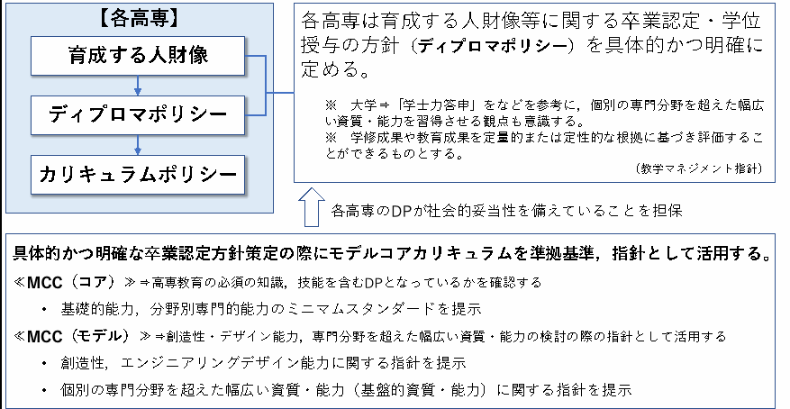

# 図7 各高専のディプロマポリシーとMCCとの関係



## 図の中の文字（原文。PDF の文字層から抽出）

```text
【各高専】
育成する人財像
ディプロマポリシー
カリキュラムポリシー
各高専は育成する人財像等に関する卒業認定・学位
授与の方針（ディプロマポリシー）を具体的かつ明確に
定める。
※大学⇒「学士力答申」をなどを参考に，個別の専門分野を超えた幅広
い資質・能力を習得させる観点も意識する。
※学修成果や教育成果を定量的または定性的な根拠に基づき評価するこ
とができるものとする。
（教学マネジメント指針）
具体的かつ明確な卒業認定方針策定の際にモデルコアカリキュラムを準拠基準，指針として活用する。
≪MCC（コア）≫⇒高専教育の必須の知識，技能を含むDPとなっているかを確認する
•基礎的能力，分野別専門的能力のミニマムスタンダードを提示
≪MCC（モデル）≫⇒創造性・デザイン能力，専門分野を超えた幅広い資質・能力の検討の際の指針として活用する
•創造性，エンジニアリングデザイン能力に関する指針を提示
•個別の専門分野を超えた幅広い資質・能力（基盤的資質・能力）に関する指針を提示
各高専のDPが社会的妥当性を備えていることを担保
```

## 書き起こし（原文ではない）

左上の「【各高専】」の枠の中に「育成する人財像」「ディプロマポリシー」「カリキュラムポリシー」の3つの箱が上から下へ並び、下向きの矢印で順につながっている。「育成する人財像」と「ディプロマポリシー」の2つの箱から出た線が1本にまとまり、右上の説明の箱に結ばれている。この説明の箱は、各高専がディプロマポリシーを具体的かつ明確に定めることを述べ、末尾に「（教学マネジメント指針）」と出典が記されている。下部には「具体的かつ明確な卒業認定方針策定の際にモデルコアカリキュラムを準拠基準，指針として活用する。」を見出しとする横長の箱があり、「≪MCC（コア）≫」と「≪MCC（モデル）≫」のそれぞれについて活用の仕方が箇条書きされている。下部の箱から右上の説明の箱へ上向きの白抜き矢印があり、その横に「各高専のDPが社会的妥当性を備えていることを担保」と書かれている。
