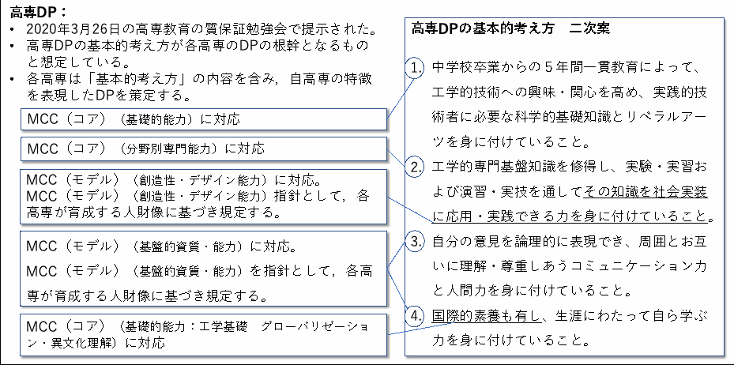

# 図8 高専DPの基本的考え方とMCCとの対応



## 図の中の文字（原文。PDF の文字層から抽出）

```text
高専DPの基本的考え方二次案
1.中学校卒業からの５年間一貫教育によって、
工学的技術への興味・関心を高め、実践的技
術者に必要な科学的基礎知識とリベラルアー
ツを身に付けていること。
2.工学的専門基盤知識を修得し、実験・実習お
よび演習・実技を通してその知識を社会実装
に応用・実践できる力を身に付けていること。
3.自分の意見を論理的に表現でき、周囲とお互
いに理解・尊重しあうコミュニケーション力
と人間力を身に付けていること。
4.国際的素養も有し、生涯にわたって自ら学ぶ
力を身に付けていること。
MCC（コア）（基礎的能力）に対応
MCC（モデル）（基盤的資質・能力）に対応。
MCC（モデル）（基盤的資質・能力）を指針として，各高
専が育成する人財像に基づき規定する。
MCC（モデル）（創造性・デザイン能力）に対応。
MCC（モデル）（創造性・デザイン能力）指針として，各
高専が育成する人財像に基づき規定する。
MCC（コア）（分野別専門能力）に対応
MCC（コア）（基礎的能力：工学基礎グローバリゼーショ
ン・異文化理解）に対応
高専DP：
•2020年3月26日の高専教育の質保証勉強会で提示された。
•高専DPの基本的考え方が各高専のDPの根幹となるもの
と想定している。
•各高専は「基本的考え方」の内容を含み，自高専の特徴
を表現したDPを策定する。
```

## 書き起こし（原文ではない）

右側に「高専DPの基本的考え方二次案」の枠があり、丸囲みの番号1〜4の4つの項目が上から並ぶ。左上には「高専DP：」の見出しで3つの箇条書きの注記があり、その下に MCC との対応を書いた5つの箱が上から並ぶ。各箱から右の項目へ線が引かれており、「MCC（コア）（基礎的能力）に対応」は項目1へ、「MCC（コア）（分野別専門能力）に対応」は項目2へ結ばれている。「MCC（モデル）（創造性・デザイン能力）に対応。」の箱は項目2のうち下線が引かれた「その知識を社会実装に応用・実践できる力を身に付けていること」の部分へ、「MCC（モデル）（基盤的資質・能力）に対応。」の箱は項目3と項目4へ線で結ばれている。最下段の「MCC（コア）（基礎的能力：工学基礎グローバリゼーション・異文化理解）に対応」の箱は、項目4のうち下線が引かれた「国際的素養も有し」の部分へ結ばれている。
