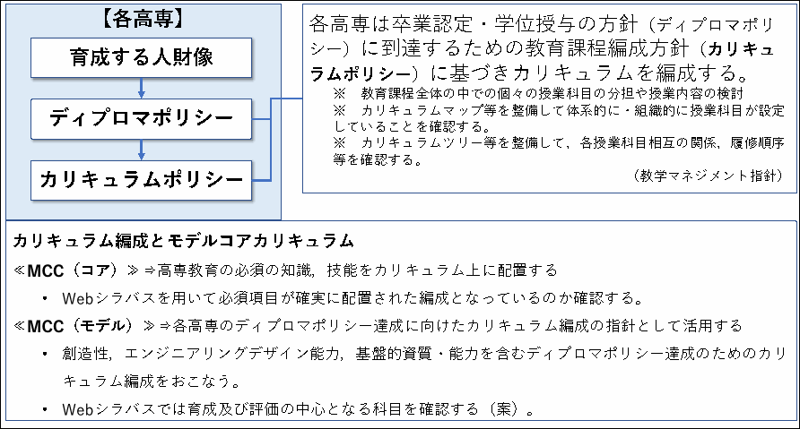

# 図9 各高専のカリキュラムポリシー及びカリキュラム編成とMCCとの関係



## 図の中の文字（原文。PDF の文字層から抽出）

```text
【各高専】
育成する人財像
ディプロマポリシー
カリキュラムポリシー
各高専は卒業認定・学位授与の方針（ディプロマポリ
シー）に到達するための教育課程編成方針（カリキュ
ラムポリシー）に基づきカリキュラムを編成する。
※教育課程全体の中での個々の授業科目の分担や授業内容の検討
※カリキュラムマップ等を整備して体系的に・組織的に授業科目が設定
していることを確認する。
※カリキュラムツリー等を整備して，各授業科目相互の関係，履修順序
等を確認する。
（教学マネジメント指針）
カリキュラム編成とモデルコアカリキュラム
≪MCC（コア）≫⇒高専教育の必須の知識，技能をカリキュラム上に配置する
•Webシラバスを用いて必須項目が確実に配置された編成となっているのか確認する。
≪MCC（モデル）≫⇒各高専のディプロマポリシー達成に向けたカリキュラム編成の指針として活用する
•創造性，エンジニアリングデザイン能力，基盤的資質・能力を含むディプロマポリシー達成のためのカリ
キュラム編成をおこなう。
•Webシラバスでは育成及び評価の中心となる科目を確認する（案）。
```

## 書き起こし（原文ではない）

左上の「【各高専】」の枠の中に「育成する人財像」「ディプロマポリシー」「カリキュラムポリシー」の3つの箱が上から下へ並び、下向きの矢印で順につながっている。「ディプロマポリシー」と「カリキュラムポリシー」の2つの箱から出た線が1本にまとまり、右上の説明の箱に結ばれている。この説明の箱は、カリキュラムポリシーに基づくカリキュラムの編成について述べ、カリキュラムマップやカリキュラムツリーに関する注記と「（教学マネジメント指針）」の出典が記されている。下部には「カリキュラム編成とモデルコアカリキュラム」を見出しとする横長の箱があり、「≪MCC（コア）≫」と「≪MCC（モデル）≫」のそれぞれについて、カリキュラム編成での扱いが箇条書きされている。
