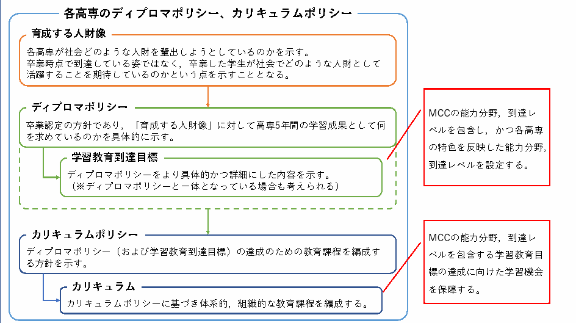

# 図10 各高専のディプロマポリシー、カリキュラムポリシー及びカリキュラムとMCCとの関係



## 図の中の文字（原文。PDF の文字層から抽出）

```text
各高専が社会どのような人財を輩出しようとしているのかを示す。
卒業時点で到達している姿ではなく，卒業した学生が社会でどのような人財として
活躍することを期待しているのかという点を示すこととなる。
育成する人財像
卒業認定の方針であり，「育成する人財像」に対して高専5年間の学習成果として何
を求めているのかを具体的に示す。
ディプロマポリシー
ディプロマポリシーをより具体的かつ詳細にした内容を示す。
（※ディプロマポリシーと一体となっている場合も考えられる）
学習教育到達目標
ディプロマポリシー（および学習教育到達目標）の達成のための教育課程を編成す
る方針を示す。
カリキュラムポリシー
カリキュラムポリシーに基づき体系的，組織的な教育課程を編成する。
カリキュラム
MCCの能力分野，到達レ
ベルを包含し，かつ各高専
の特色を反映した能力分野，
到達レベルを設定する。
MCCの能力分野，到達レ
ベルを包含する学習教育目
標の達成に向けた学習機会
を保障する。
各高専のディプロマポリシー、カリキュラムポリシー
```

## 書き起こし（原文ではない）

「各高専のディプロマポリシー、カリキュラムポリシー」と題した大きな枠の中に、「育成する人財像」（オレンジ）、「ディプロマポリシー」（緑）、「カリキュラムポリシー」（紺）の3つの箱が上から下へ並び、下向きの矢印でつながっている。「ディプロマポリシー」の下には、右に字下げした「学習教育到達目標」の箱が矢印で枝分かれして置かれ、この2つの箱は緑の点線で一緒に囲まれている。同じように「カリキュラムポリシー」の下には、右に字下げした「カリキュラム」の箱が矢印で枝分かれして置かれている。各箱には、それが何を示すかの説明文が入っている。枠の右側には赤い枠の注記が2つあり、上の注記は赤い線で「学習教育到達目標」の箱に、下の注記は「カリキュラム」の箱に結ばれている。
