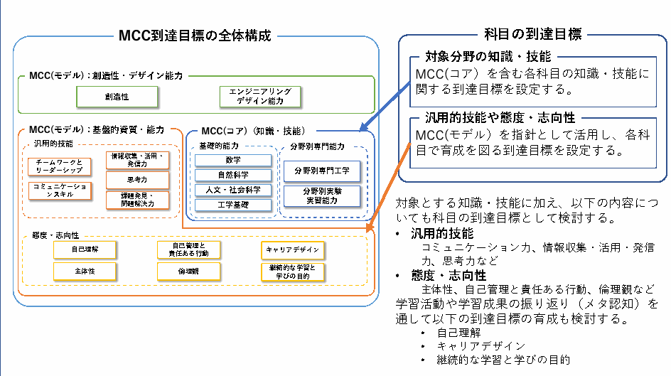

# 図11 一般科目、専門科目の講義系科目の授業設計とMCC(コア)、MCC(モデル)の関係



## 図の中の文字（原文。PDF の文字層から抽出）

```text
MCC(モデル)：創造性・デザイン能力
MCC(モデル)：基盤的資質・能力
MCC(コア)（知識・技能）
基礎的能力
数学
自然科学
人文・社会科学
工学基礎
分野別専門能力
分野別専門工学
分野別実験
実習能力
汎用的技能
コミュニケーショ
ンスキル
チームワークと
リーダーシップ
情報収集・活用・
発信力
思考力
課題発見・
問題解決力
態度・志向性自己理解
主体性
自己管理と
責任ある行動
倫理観
キャリアデザイン
継続的な学習と
学びの目的
創造性
エンジニアリング
デザイン能力
MCC到達目標の全体構成
科目の到達目標
MCC(コア）を含む各科目の知識・技能に
関する到達目標を設定する。
対象分野の知識・技能
MCC(モデル）を指針として活用し、各科
目で育成を図る到達目標を設定する。
汎用的技能や態度・志向性
対象とする知識・技能に加え、以下の内容につ
いても科目の到達目標として検討する。
•汎用的技能
コミュニケーション力、情報収集・活用・発信
力、思考力など
•態度・志向性
主体性、自己管理と責任ある行動、倫理観など
学習活動や学習成果の振り返り（メタ認知）を
通して以下の到達目標の育成も検討する。
•自己理解
•キャリアデザイン
•継続的な学習と学びの目的
```

## 書き起こし（原文ではない）

左側に「MCC到達目標の全体構成」の図があり、「MCC(モデル)：創造性・デザイン能力」「MCC(モデル)：基盤的資質・能力」「MCC(コア)（知識・技能）」の3つの枠とその中の要素が描かれている。右上には紺の枠「科目の到達目標」があり、「対象分野の知識・技能」と「汎用的技能や態度・志向性」の2つの区画を含む。「対象分野の知識・技能」の区画からは青い矢印が左の「MCC(コア)（知識・技能）」の枠へ、「汎用的技能や態度・志向性」の区画からはオレンジの矢印が左の「態度・志向性」の区画の右端へ向かっている。右下には、科目の到達目標として検討する内容として「汎用的技能」「態度・志向性」と、振り返り（メタ認知）を通して育成を検討する「自己理解」「キャリアデザイン」「継続的な学習と学びの目的」が箇条書きされている。
