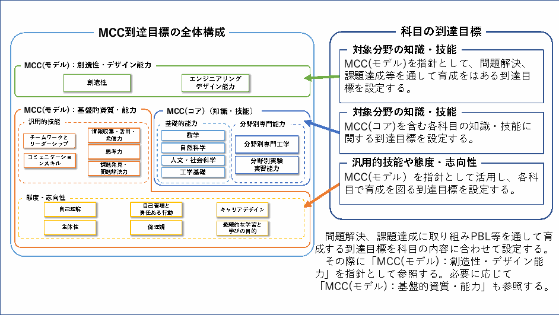

# 図12 問題解決・課題達成を図る授業設計とMCC(コア)、MCC(モデル)の関係



## 図の中の文字（原文。PDF の文字層から抽出）

```text
MCC(モデル)：創造性・デザイン能力
MCC(モデル)：基盤的資質・能力
MCC(コア)（知識・技能）
基礎的能力
数学
自然科学
人文・社会科学
工学基礎
分野別専門能力
分野別専門工学
分野別実験
実習能力
汎用的技能
コミュニケーショ
ンスキル
チームワークと
リーダーシップ
情報収集・活用・
発信力
思考力
課題発見・
問題解決力
態度・志向性自己理解
主体性
自己管理と
責任ある行動
倫理観
キャリアデザイン
継続的な学習と
学びの目的
創造性
エンジニアリング
デザイン能力
MCC到達目標の全体構成
科目の到達目標
MCC(モデル)を指針として、問題解決、
課題達成等を通して育成をはある到達目
標を設定する。
対象分野の知識・技能
MCC(コア)を含む各科目の知識・技能に
関する到達目標を設定する。
対象分野の知識・技能
問題解決、課題達成に取り組みPBL等を通して育
成する到達目標を科目の内容に合わせて設定する。
その際に「MCC(モデル)：創造性・デザイン能
力」を指針として参照する。必要に応じて
「MCC(モデル)：基盤的資質・能力」も参照する。
MCC(モデル）を指針として活用し、各科
目で育成を図る到達目標を設定する。
汎用的技能や態度・志向性
```

## 書き起こし（原文ではない）

左側に「MCC到達目標の全体構成」の図があり、「MCC(モデル)：創造性・デザイン能力」「MCC(モデル)：基盤的資質・能力」「MCC(コア)（知識・技能）」の3つの枠とその中の要素が描かれている。右側の紺の枠「科目の到達目標」には3つの区画があり、上の2つはどちらも「対象分野の知識・技能」、3つ目は「汎用的技能や態度・志向性」という見出しを持つ。1つ目の区画（MCC(モデル)を指針とする到達目標）からは緑の矢印が左の「MCC(モデル)：創造性・デザイン能力」の枠へ、2つ目の区画（MCC(コア)を含む到達目標）からは青い矢印が「MCC(コア)（知識・技能）」の枠へ、3つ目の区画からはオレンジの矢印が「態度・志向性」の区画の右端へ向かっている。右下には、問題解決、課題達成に取り組む PBL 等を通して育成する到達目標の設定と、その際に参照する MCC(モデル) について説明する文がある。
