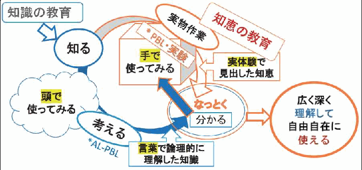

# 図13 知識と知恵の教育

## 図の中の文字（原文。PDF の文字層から抽出）

（図の中に文字層の文字はない）

## 書き起こし（原文ではない）

左上の「知識の教育」と右上の「知恵の教育」の2つの札があり、中央下の「なっとく」と書かれた楕円（中に「分かる」の箱）に向かって両側から矢印が集まる構成の図。左側では、「知識の教育」から白抜き矢印が楕円「知る」を指し、青い曲線が雲形の「頭で使ってみる」の脇を通って楕円「考える」（「*AL-PBL」の添え書き）に至り、「なっとく」の楕円へ続いている。「考える」の下には「言葉で論理的に理解した知識」の箱があり、上向きの矢印が添えられている。右側には楕円「実物作業」と立方体「手で使ってみる」（「* PBL・実験」の添え書き）があり、オレンジの曲線と「実体験で見出した知恵」の箱からの矢印が「なっとく」の楕円へ向かい、「なっとく」の付近から太い青い矢印が立方体へ向かっている。「なっとく」の楕円からは右向きの白抜き矢印が、オレンジの円「広く深く理解して自由自在に使える」へ伸びている。「知る」から右へ伸びる灰色の帯など、一部の矢印のつながりは判読できない。
