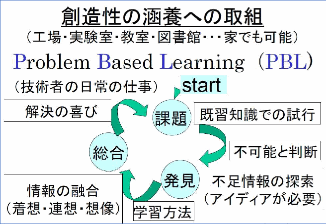

# 図14 創造性涵養の取組み

## 図の中の文字（原文。PDF の文字層から抽出）

（図の中に文字層の文字はない）

## 書き起こし（原文ではない）

上部に「創造性の涵養への取組」の題と「（工場・実験室・教室・図書館・・・家でも可能）」の添え書きがあり、その下に「Problem Based Learning（PBL）」と「（技術者の日常の仕事）」が書かれている。中央には「課題」「発見」「総合」の3つの円が三角形に配置され、緑の曲線の矢印で「課題」→「発見」→「総合」→「課題」の順に循環している。「課題」の上には「start」の文字があり、短い矢印で「課題」を指している。「課題」から「発見」への矢印の脇には「既習知識での試行」と「不可能と判断」、「発見」の右下には「不足情報の探索（アイディアが必要）」、「発見」から「総合」への矢印の脇には「学習方法」、「総合」の左下には「情報の融合（着想・連想・想像）」、「総合」から「課題」への矢印の脇には「解決の喜び」が添えられている。
