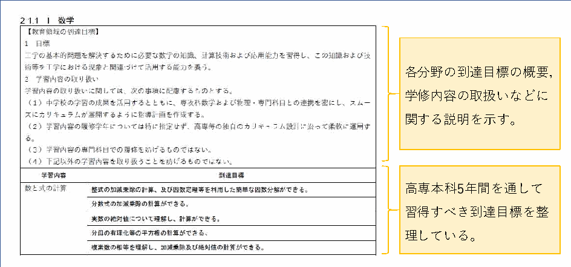

# 図1 様式1 MCC(コア)分野共通の基礎的能力用



## 図の中の文字（原文。PDF の文字層から抽出）

```text
各分野の到達目標の概要，
学修内容の取扱いなどに
関する説明を示す。
高専本科5年間を通して
習得すべき到達目標を整
理している。
```

## 書き起こし（原文ではない）

左側に、様式1の記載例としてページの画像（見出しは画像から「数学」と読める）が置かれている。ページの上部は教育領域の到達目標についての文章、下部は学習内容と到達目標を2列で並べた表になっている。右側には黄色の説明の箱が2つあり、上部の文章の部分には黄色の括弧で「各分野の到達目標の概要，学修内容の取扱いなどに関する説明を示す。」の箱が、下部の表には同じく黄色の括弧で「高専本科5年間を通して習得すべき到達目標を整理している。」の箱が対応している。
