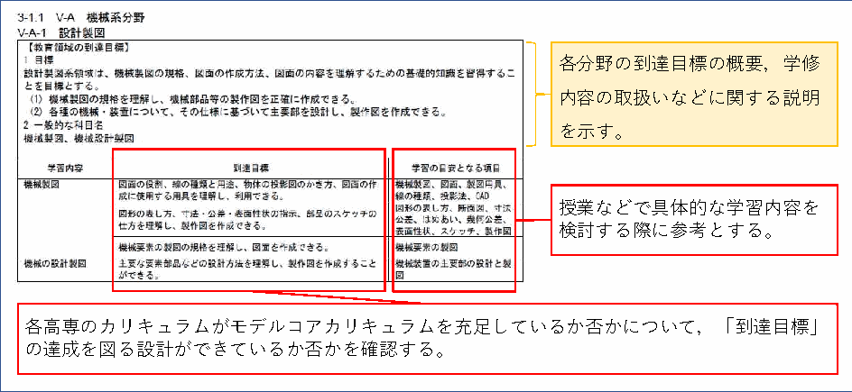

# 図2 様式2 MCC(コア)分野別専門的能力及び工学基礎用



## 図の中の文字（原文。PDF の文字層から抽出）

```text
各分野の到達目標の概要，学修
内容の取扱いなどに関する説明
を示す。
授業などで具体的な学習内容を
検討する際に参考とする。
各高専のカリキュラムがモデルコアカリキュラムを充足しているか否かについて，「到達目標」
の達成を図る設計ができているか否かを確認する。
```

## 書き起こし（原文ではない）

左側に、様式2の記載例としてページの画像（見出しは画像から「機械系分野」「設計製図」と読める）が置かれている。ページの上部は教育領域の到達目標についての文章、下部は3列の表で、表の中央の列と右の列（列見出しは画像から「到達目標」「学習の目安となる項目」と読める）がそれぞれ赤い枠で囲まれている。上部の文章の部分には、黄色の括弧で「各分野の到達目標の概要，学修内容の取扱いなどに関する説明を示す。」の箱が対応している。右の列の赤い枠からは赤い線が右の「授業などで具体的な学習内容を検討する際に参考とする。」の箱へ、中央の列の赤い枠からは赤い線が下部の「各高専のカリキュラムがモデルコアカリキュラムを充足しているか否かについて，」で始まる箱へ伸びている。
