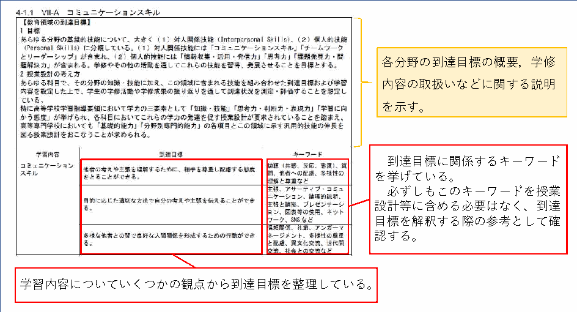

# 図3 様式3 MCC(モデル)用



## 図の中の文字（原文。PDF の文字層から抽出）

```text
各分野の到達目標の概要，学修
内容の取扱いなどに関する説明
を示す。
学習内容についていくつかの観点から到達目標を整理している。
到達目標に関係するキーワード
を挙げている。
必ずしもこのキーワードを授業
設計等に含める必要はなく、到達
目標を解釈する際の参考として確
認する。
```

## 書き起こし（原文ではない）

左側に、様式3の記載例としてページの画像（見出しは画像から「コミュニケーションスキル」と読める）が置かれている。ページの上部は教育領域の到達目標についての文章、下部は3列の表で、中央の列の3つの行がそれぞれ赤い枠で囲まれ、右の列（列見出しは画像から「キーワード」と読める）も赤い枠で囲まれている。上部の文章の部分には、黄色の括弧で「各分野の到達目標の概要，学修内容の取扱いなどに関する説明を示す。」の箱が対応している。中央の列の赤い枠からは赤い線が下部の「学習内容についていくつかの観点から到達目標を整理している。」の箱へ、右の列の赤い枠からは赤い線が右の「到達目標に関係するキーワードを挙げている。」で始まる箱へ伸びている。
