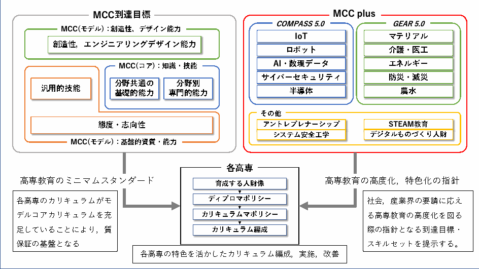

# 図1 MCC到達目標とMCC plus



## 図の中の文字（原文。PDF の文字層から抽出）

```text
MCC到達目標
汎用的技能
態度・志向性
MCC(モデル)：基盤的資質・能力
MCC(コア)：知識・技能
分野共通の
基礎的能力
分野別
専門的能力
MCC(モデル)：創造性，デザイン能力
創造性，エンジニアリングデザイン能力
MCCplus
COMPASS5.0
IoT
ロボット
AI・数理データ
サイバーセキュリティ
半導体
GEAR5.0
マテリアル
介護・医工
エネルギー
防災・減災
農水
その他
アントレプレナーシップ
システム安全工学
STEAM教育
デジタルものづくり人財
各高専
育成する人財像
ディプロマポリシー
カリキュラムマポリシー
カリキュラム編成
高専教育のミニマムスタンダード
高専教育の高度化，特色化の指針
各高専のカリキュラムがモ
デルコアカリキュラムを充
足していることにより，質
保証の基盤となる
社会，産業界の要請に応え
る高専教育の高度化を図る
際の指針となる到達目標・
スキルセットを提示する。
各高専の特色を活かしたカリキュラム編成，実施，改善
```

## 書き起こし（原文ではない）

上段の左に灰色の枠「MCC到達目標」、右に赤い枠「MCCplus」があり、下段の中央に「各高専」の箱がある。「MCC到達目標」の中には、緑の枠「MCC(モデル)：創造性，デザイン能力」（「創造性，エンジニアリングデザイン能力」）、青い枠「MCC(コア)：知識・技能」（「分野共通の基礎的能力」「分野別専門的能力」）、青い枠の左と下を取り囲むオレンジの枠「MCC(モデル)：基盤的資質・能力」（「汎用的技能」「態度・志向性」）がある。「MCCplus」の中には、青い枠「COMPASS5.0」（5項目）、緑の枠「GEAR5.0」（5項目）、黄色の枠「その他」（4項目）がある。「MCC到達目標」と「MCCplus」からは灰色の太い矢印が下に伸びて折れ、左右から「各高専」の箱を指しており、左の矢印には「高専教育のミニマムスタンダード」、右の矢印には「高専教育の高度化，特色化の指針」と添えられ、それぞれの下に説明の箱がある。「各高専」の箱の中には「育成する人財像」から「カリキュラム編成」までの4つの箱が下向きの矢印でつながり、その下に「各高専の特色を活かしたカリキュラム編成，実施，改善」と書かれた箱がある。
