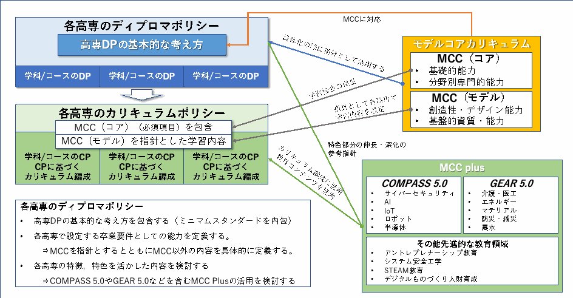

# 図2 各高専のディプロマポリシー、カリキュラムポリシーとMCC、MCC plusの関係



## 図の中の文字（原文。PDF の文字層から抽出）

```text
各高専のディプロマポリシー
高専DPの基本的な考え方
学科/コースのDP
学科/コースのDP
学科/コースのDP
各高専のカリキュラムポリシー
学科/コースのCP
CPに基づく
カリキュラム編成
学科/コースのCP
CPに基づく
カリキュラム編成
学科/コースのCP
CPに基づく
カリキュラム編成
MCC（コア）（必須項目）を包含
MCC（モデル）を指針とした学習内容
モデルコアカリキュラム
MCC（コア）
•基礎的能力
•分野別専門的能力
MCC（モデル）
•創造性・デザイン能力
•基盤的資質・能力
MCC plus
COMPASS 5.0
•
サイバーセキュリティ
•
AI
•
IoT
•
ロボット
•
半導体
GEAR 5.0
•
介護・医工
•
エネルギー
•
マテリアル
•
防災・減災
•
農水
その他先進的な教育領域
•
アントレプレナーシップ教育
•
システム安全工学
•
STEAM教育
•
デジタルものづくり人財育成
特色部分の伸長・深化の
参考指針
各高専のディプロマポリシー
•高専DPの基本的な考え方を包含する（ミニマムスタンダードを内包）
•各高専で設定する卒業要件としての能力を定義する。
⇒MCCを指針とするとともにMCC以外の内容を具体的に定義する。
•各高専の特徴，特色を活かした内容を検討する
⇒COMPASS 5.0やGEAR 5.0などを含むMCC Plusの活用を検討する
MCCに対応
```

## 書き起こし（原文ではない）

左上に「各高専のディプロマポリシー」の箱（中に「高専DPの基本的な考え方」と3つの「学科/コースのDP」）があり、その下に白抜きの下向き矢印を挟んで「各高専のカリキュラムポリシー」の箱（「MCC（コア）（必須項目）を包含」「MCC（モデル）を指針とした学習内容」の2行と、3つの「学科/コースのCP」「CPに基づくカリキュラム編成」）がある。右上にはオレンジの枠「モデルコアカリキュラム」（「MCC（コア）」と「MCC（モデル）」）、右下には緑の枠「MCC plus」（「COMPASS 5.0」「GEAR 5.0」「その他先進的な教育領域」）がある。「モデルコアカリキュラム」からは「MCCに対応」と添えられたオレンジの線が「高専DPの基本的な考え方」の箱を指し、「MCC（コア）」からは青い線が「各高専のディプロマポリシー」へ、「MCC（コア）」「MCC（モデル）」からは灰色の線がカリキュラムポリシーの2行へそれぞれ引かれている。「MCC plus」からは緑の線が2本伸びて「各高専のディプロマポリシー」と「各高専のカリキュラムポリシー」へ向かい、そばに「特色部分の伸長・深化の参考指針」と書かれている。青・灰・緑の線に沿って斜めの小さな文字が添えられているが、判読できない。左下には「各高専のディプロマポリシー」についての箇条書きの説明の箱がある。
