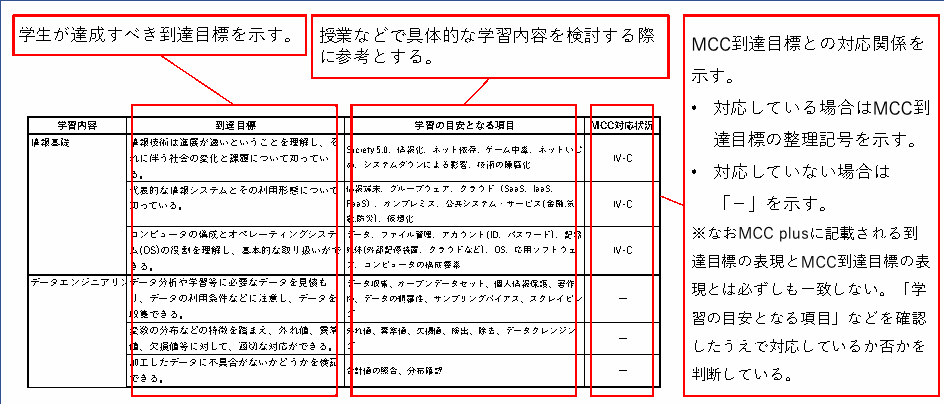

# 図3 MCC plusの記載様式



## 図の中の文字（原文。PDF の文字層から抽出）

```text
学習内容
到達目標
学習の目安となる項目
MCC対応状況
情報基礎
情報技術は進展が速いということを理解し、そ
れに伴う社会の変化と課題について知ってい
る。
Society 5.0，情報化，ネット依存，ゲーム中毒，ネットいじ
め，システムダウンによる影響，技術の陳腐化
Ⅳ-C
代表的な情報システムとその利用形態について
知っている。
情報端末，グループウェア，クラウド（SaaS，IaaS，
PaaS），オンプレミス，公共システム・サービス(金融,気
象,防災)，仮想化
Ⅳ-C
コンピュータの構成とオペレーティングシステ
ム(OS)の役割を理解し、基本的な取り扱いがで
きる。
データ，ファイル管理，アカウント(ID，パスワード)，記録
媒体(外部記憶装置，クラウドなど)，OS，応用ソフトウェ
ア，コンピュータの構成要素
Ⅳ-C
データエンジニアリング
データ分析や学習等に必要なデータを見積も
り、データの利用条件などに注意し、データを
収集できる。
データ収集、オープンデータセット、個人情報保護、著作
権、データの網羅性、サンプリングバイアス、スクレイピン
グ
ー
変数の分布などの特徴を踏まえ、外れ値、異常
値、欠損値等に対して、適切な対応ができる。
外れ値、異常値、欠損値、検出、除去、データクレンジン
グ
ー
加工したデータに不具合がないかどうかを検証
できる。
合計値の照合、分布確認
ー
学生が達成すべき到達目標を示す。授業などで具体的な学習内容を検討する際
に参考とする。
MCC到達目標との対応関係を
示す。
•対応している場合はMCC到
達目標の整理記号を示す。
•対応していない場合は
「－」を示す。
※なおMCCplusに記載される到
達目標の表現とMCC到達目標の表
現とは必ずしも一致しない。「学
習の目安となる項目」などを確認
したうえで対応しているか否かを
判断している。
```

## 書き起こし（原文ではない）

「学習内容」「到達目標」「学習の目安となる項目」「MCC対応状況」の4列の表があり、「情報基礎」と「データエンジニアリング」の2つの学習内容について、それぞれ3行の到達目標が並ぶ。「MCC対応状況」の列には、「情報基礎」の行に「Ⅳ-C」、「データエンジニアリング」の行に「ー」が記されている。「到達目標」「学習の目安となる項目」「MCC対応状況」の3列はそれぞれ赤い枠で囲まれ、赤い線で説明の箱に結ばれている。「到達目標」の列は上の「学生が達成すべき到達目標を示す。」の箱へ、「学習の目安となる項目」の列は上の「授業などで具体的な学習内容を検討する際に参考とする。」の箱へ、「MCC対応状況」の列は右の「MCC到達目標との対応関係を示す。」で始まる箱へ結ばれている。
