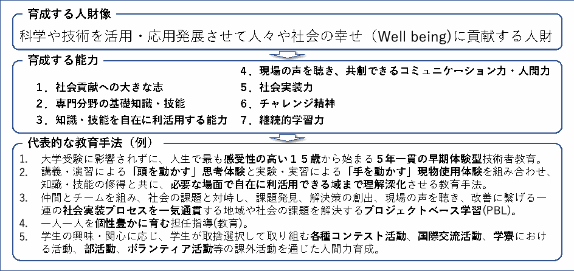

## 2-1 国立高等専門学校が育成する人財像

「協力者会議報告書」[17]では技術者について「数学、自然科学の知識を用いて、公衆の健康・安全への考慮、文化的、社会的及び環境的な考慮を行い、人類のために設計、開発、イノベーション又は解決の活動を担う専門的職業人」と定義している。先述のとおり、「協力者会議報告書」は大学における技術者教育を対象としており、高専での技術者教育を直接の対象としているわけではない。もっとも高専教育は早期高等教育の実施によって大学学部に比肩する専門教育を実施している以上、育成する技術者像については「協力者会議報告」を踏まえた上で、高専教育の独自性、特長を示すことが適切である。

高専は技術者教育を中核としながら、多様な分野の人材育成を行っている。したがって、技術者を範とした上で、国立高専では育成する人材像を「科学や技術を活用・応用発展させることで社会や人々の幸せ（Well being）に貢献する専門人財※」と定義する[18]。高専で学んだ知識、技術、技能などをさらに発展させて、新たに創り出した革新的な技術やアイデアで健全で持続的な社会を創造することができる人財である。

このような人財は以下の特徴を備えている。

1. 個々人と社会全体の幸福を希求し、専門職としての活動の影響を踏まえて行動する責任を自覚していること

2. 技術を活用して社会実装ができるそれぞれ各人の専門領域において必要な最低限の知識・ 技能を身につけることで、広い意味でのものづくりの生産現場やことづくりの現場を理解していること

3. その専門分野における知識・技能の内容を、基本原理を踏まえて体系的に身につけていることで、ものづくりの開発現場やことづくりの現場に必要な専門知識を応用できる力（エンジニアとしての技術力）を習得していること

4. 生産現場、開発現場においては、この両者はもとより、社会との連携を橋渡しすることができる多面的なコミュニケーション力を身につけていること

5. 既存の価値の向上や新しい価値の創出を技術の力を活用して実現する（社会実装するために、企画立案から開発、生産、社会展開まで幅広く携われる能力を身につけていること

6. 既存の価値の向上や新しい価値の創出を実現するために前に踏み出す力やチャレンジ精神を身につけていること

7. 自らの知識を常に最新のものに保ち，かつ新たな知識を取り入れるため、広い視野の下で 学びつづける姿勢を身につけていること

※ 国立高専では育成する人材を「人財」と表現する。なお、この「人財」とは、各分野で学びを深めた専門的職業人としての基盤を有し、社会変革を推進できる人財であり、工学系分野においては「技術者」としての基盤を有する人財であり、そのほかの商船分野や経済・ビジネス系分野においては、それぞれ「海事技術者」、社会の発展を経済・ビジネスの観点から全体的に評価推進できる「経済・ビジネス系企業人財」と読み替えることができる。

このような人材育成を可能としているのが先述（1-2）の特長を備えた高専教育である（図1）。特に高専教育では具体的な課題に取組み、試行錯誤を繰り返しながら、問題発見、問題解決を図る学習活動を通して知識、技術を社会課題に活用する力と態度を育む教育を実践してきており、これらの教育をさらに普及、発展させていくことが求められる。

（図の書き起こし: [fig-023-1.md](../figures/fig-023-1.md)、mcc2023:doc:017）

図1 国立高専が育成する人財像、能力と代表的な教育手法
