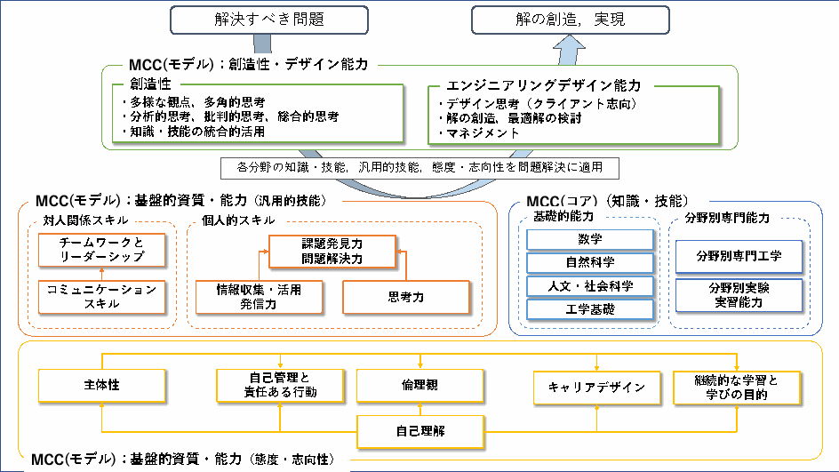

## 2-2 技術者教育を構成する要素とMCCの到達目標

社会の様々な問題を解決し、多様なニーズに応える役割を担う技術者は、一般的な知識・技能、専門分野の知識・技能を習得するだけでなく、あらゆる分野に共通する技能（汎用的技能）の育成、あるいは学びや活動の基盤となる態度・志向性などを涵養した上で、具体的な問題解決を目指した学習活動を通して、問題解決や課題達成に必要となる資質・能力を育てる必要がある。MCCは、先述の「協力者会議報告書」で示された技術者像を範とし、これを育成するための教育の構成要素に対応し、かつ高専本科5年間という修業年限を考慮した到達目標を整理している（図2）。

（図の書き起こし: [fig-023-2.md](../figures/fig-023-2.md)、mcc2023:doc:019）

図2 MCC到達目標の全体構成

（「大学における実践的な技術者教育の在り方に関する協力者会議」（平成22年6月）、「技術者教育に関する分野別の到達目標の設定に関する調査研究」（平成24年4月）等を参考に整理）
