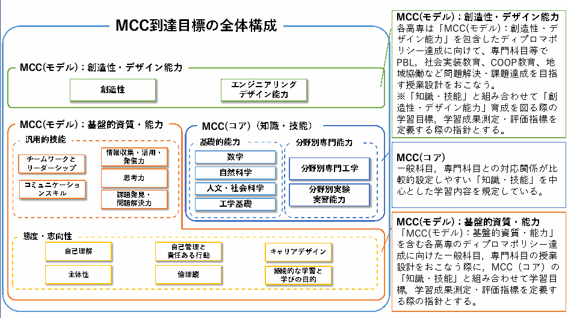

### 2-3.2 MCC(モデル)

MCC(モデル)は、「MCC(モデル)：基盤的資質・能力」及び「MCC(モデル)：創造性・デザイン能力」から構成される。MCC(モデル)は特定の科目との対応関係を明確に定めることが困難であり、各高専のカリキュラム全体を通して達成を図る到達目標について整理したものである。卒業認定の方針（以下、「ディプロマポリシー」という。）及びその達成のために編成されるカリキュラムにおいて、MCC(モデル)に含まれる到達目標をどのように表現し、また、育成、評価を行うのかについては、各高専の特色に応じた独自の設計が考えられる。そのためMCC(モデル)は、各高専のディプロマポリシーの設定、カリキュラム編成の指針として活用されることを想定している。MCC(モデル)を指針として各高専がカリキュラム編成を行うことにより、結果的にMCC(モデル)に含まれる到達目標を包含するものとなる。

（図の書き起こし: [fig-024-1.md](../figures/fig-024-1.md)、mcc2023:doc:023）

図3 MCC(コア)とMCC(モデル)
