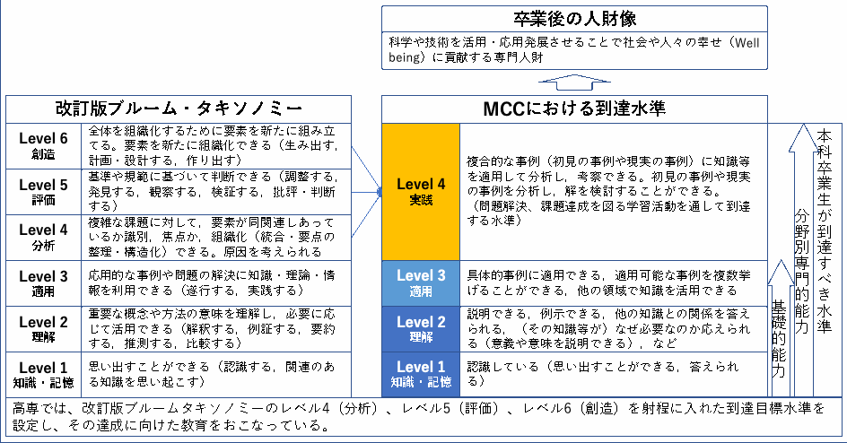

### 2-5.1 MCC(コア)の到達目標水準の考え方

MCC(コア)に含まれる学習内容に関する到達水準の考え方を図4に示す。

高専における学習は単なる知識の集積で終わることなく、くさび型教育により早くから専門分野を学習し、講義などで理解した内容を具体的事例に適用するような学習活動、あるいは実験・実習などで実際に知識を活用、体験する学びによって知識を自在に利活用できる域まで理解を深める。この到達水準をレベル3（適用）と設定している。さらに各高専では学生が仲間とチームを組んで現実社会の課題と対峙し、問題の本質を分析、把握して、適切に解決を試みる社会実装型のPBLなどを通して、複雑で未知な問題に対して科学知識、専門知識、技術を駆使して解を創造するという学習活動を行っている。高専教育の神髄ともいえるこのような学習活動によって到達できる水準は、改訂版ブルーム・タキソノミーのレベル4（分析）、レベル5（評価）、レベル6（創造）を含むものである。したがって、MCC(コア)における分野別の専門的能力について、学生が卒業までに到達すべき水準をレベル4（実践）と定義し、改訂版ブルーム・タキソノミーのレベル4から6までを含むものとする。この到達水準の考え方に基づき、本科5年間の学習成果として、分野共通の基礎的専門能力はレベル3まで、分野別専門的能力はレベル4までの到達を図るものと設定する。

（図の書き起こし: [fig-026-1.md](../figures/fig-026-1.md)、mcc2023:doc:027）

図4 MCC(コア)における到達水準の考え方

なお、各高専での具体的なカリキュラム編成にあたっては、必ずしも到達レベル 1（知識・記憶）から段階的に積み上げる必要はない。たとえば、科目の接続や学年進行にともなって、ある学習内容の到達目標に関する到達レベルを段階的に積み上げていく場合には、到達レベル 1（知識・記憶）から到達レベル3（適用）までの到達度の確認を段階的に行うこととなる。一方、ある学習内容の到達目標に対して、到達レベル3（適用）の到達を図る科目や活動のみが設定されている場合には、到達レベル3（適用）の到達が確認できた時点で解のレベル（レベル１、２）についても到達したとみなせる（表 4）。このような考え方に基づき、各高専では科目間でのシラバス、授業内容などの確認を行い、学習内容とその到達度の整合性などについて十分確認する必要がある。

表4 到達レベルとカリキュラム編成の考え方例

| 到達レベル1 | 到達レベル2 | 到達レベル3 | 備考 |
|---|---|---|---|
| ○ | ○ | ○ | ある学習内容の到達目標に対する到達レベルを段階的に積み上げる科目を準備した場合 |
| → | → | ○ | ある学習内容の到達目標に対して到達レベル3の科目のみが設定されている場合には、到達レベル3への到達によって到達レベル1と2についても到達したものとみなせる。 |

#### MCC(コア)の到達目標水準に関する補足説明

MCC(コア)の到達水準は決して難易度を示すものではない。確かに知識の習得、理解、適用、実践へと学習活動は複雑性を増しており、その意味で高位の水準は下位の水準を含んでいるため、難易度が高くなっているように捉えられるのもやむを得ない。しかしこの段階的水準が示しているのは、知識を習得した上でどのような学習活動を行うのか、さらにどのような学習成果を求めているのかという点で複雑性が増加しているということである。したがって、決して学力が高い学生のみが到達できるという意味で高位の水準が設定されているのではない。到達水準に達した学生間で成績の優劣は当然生じうるが、卒業を認められた学生は設定された到達水準に達しているということである※。

※ 認知的学習領域の到達水準の例としては適切ではないかもしれないが、スポーツに必要な技能を例に

説明をおこないたい。たとえばバスケットボールでは、走る技術やボールを投げる技術、ボールを受ける

技術、ドリブルの技術、シュートの技術、さらにディフェンスの技術やセットプレイなど様々な技術が必

要であり、それらを段階的に学びながら、最終的には試合に臨むこととなる。これをMCC(コア)の到達水準モデルに当てはめると、以下のように表現される。

レベル1：フットワークができる、パスを受けることができる、ドリブルができる

レベル2：走りながらお互いにパスができる、ディフェンスを避けながらドリブルができる

レベル3：習得した技術を発揮して試合形式でのチームプレイができる

レベル4：実際のゲームで、自分たちの戦略に従って各自判断しながらチームプレイができる

高位のレベルは低位のレベルと比較すると（学習）活動と（学習）成果の複雑性が増加しているが、優

秀なものでなければレベル4に到達できないということではない。各レベルで学習者によって優劣はあると考えられるが、レベル4に規定される「実際のゲームで、自分たちの戦略に従って各自判断しながらチームプレイができる」という水準での（学習）活動ができないということはないだろう。高専教育におい

ても、レベル4に設定している問題解決・課題達成を目指した学習活動をすべての学生が体験することは可能であり、そこで要求する水準を達成することは十分可能であると考えられる。
