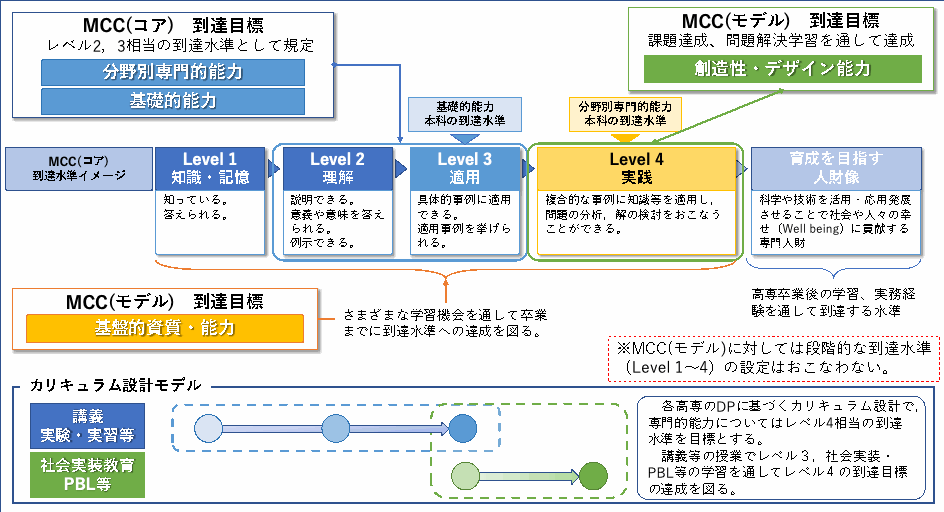

### 2-5.2 MCC(モデル)の到達目標水準の考え方

MCC(モデル)に含まれる学習内容は、認知的学習領域を対象とした知識の習得、理解、適用、実践という段階的な水準で整理することが適さないものも含まれている。たとえばMCC(モデル)：基盤的資質・能力に含まれる態度・志向性は、知識の習得によって形成されるだけでなく、学習者の思考や行動の基盤となるものである。これらは知識の習得、応用という学習過程だけでなく、多様な視点や自分と異なる考え方、価値観への気づき、思考や行動の基盤にある態度や考え方、特性の認知などを踏まえた上で、求められる行動を実践しようとする意図的な学習活動により変容がもたらされるものと考えられる。また、同じくMCC(モデル)：基盤的資質・能力に含まれる汎用的技能は知識を与えられて、それらを習得、理解するだけでなく、行動、実践を通してそれぞれの技能を発揮しながら形成される能力である。つまりMCC(モデル)：基盤的資質・能力はその性質から実践的な学習活動を通して育成が図られ、その成果を測定、評価することが重要となる。したがって、MCC(モデル)：基盤的資質・能力は、改訂版ブルーム・タキソノミーの認知的学習領域モデルが示すように知識、理解、応用、分析という形で段階的に発展するものと捉えるのではなく、高専の学生が卒業までに習得すべき水準のみを設定することが適切である。

さらにMCC(モデル)：創造性・デザイン能力は具体的な問題解決、課題達成を目指した学習活動の中で育成することが必要となる。それゆえMCC(モデル)：創造性・デザイン能力は、MCC(コア)に適用される認知的学習領域に関する改訂版ブルーム・タキソノミーを参考に高専教育で到達すべき水準として設定したモデルでいえばレベル 4（実践）に相当する学習活動の中で育成される学習内容である。そこでMCC(モデル)：創造性・デザイン能力についても、学生が卒業までに到達すべき水準のみを示す。

MCC(モデル)については、MCC(コア)に適用される、知識の利活用に関する複雑性が増加するという観点から整理されている到達水準（Level 1～4）とは異なる観点から高専5 年間で習得すべき到達水準として設定する。すなわちレベル1からレベル3（ないし4）の段階的なレベル設定は適用せず、MCC(モデル)に示される到達目標に示される指標を指針として各高専が卒業までに習得すべき学習教育目標を示すものと位置づける。

各高専がディプロマポリシーの達成のために編成するカリキュラムにおいて、上述のようにMCC(コア)に含まれる基礎的能力はレベル3以上、分野別専門的能力はレベル4以上の到達を図ることとなる。特に分野別専門的能力をレベル 4 までの到達を図る際には PBL や社会実装をなどの学習活動を導入したカリキュラム設計が必要となる。また、MCC(モデル)については、参考資料として提示する標準ルーブリック等を参考に、各高専において具体的な到達水準を規定した上でその達成に向けたカリキュラムの編成、授業の設計を行い、学習機会の保証と学習成果の測定・評価を行うことが求められる。（図5）。

（図の書き起こし: [fig-028-1.md](../figures/fig-028-1.md)、mcc2023:doc:029）

図5 MCCにおける到達水準とカリキュラム設計の関係
