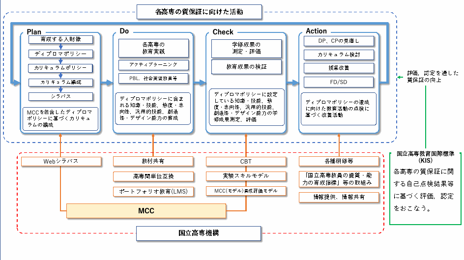

## 3-1 各高専の質保証の取り組みとMCC

MCC の到達目標はすべての高専生が身に付けるべき能力に関するミニマムスタンダードを示すものである。各高専はそれぞれのディプロマポリシー（及びそれをさらに具体化した学習教育目標）（以下、特に支障がない限りディプロマポリシー及び学習・教育目標を合わせて「ディプロマポリシー」と表記する。）を達成するためのカリキュラムを編成しており、その中にMCCが包含される。各高専に求められる教育の質保証は、MCC 到達目標を包含するディプロマポリシーが達成されているということ、ディプロマポリシーの達成のためのカリキュラム編成方針（以下、「カリキュラムポリシー」という。）に基づき編成されるカリキュラムが実施され、その成果を測定・評価した結果に基づき組織的に改善するサイクル、すなわちPDCAサイクルが機能していることである。

各高専の質保証のためのPDCAサイクルに基づく活動を支援、促進するために、国立高専機構はMCC及び関連システム、ツールを提供し、様々な取組みを実施している（図6）。

（図の書き起こし: [fig-029-1.md](../figures/fig-029-1.md)、mcc2023:doc:032）

図6 各高専の質保証PDCAサイクルとMCC及び高専機構の取組み

Plan 各高専はそれぞれの特徴や特色を反映させた育成する人財像を設定した上で、MCC に記載される到達目標も包含したディプロマポリシーを策定し、これを達成するためのカリキュラムポリシーを設定して、これに基づきカリキュラムを編成することとなる。個々の教員は、所属高専のディプロマポリシーと担当科目との関係を把握した上で、個々の科目の到達目標と学習内容を設定してシラバスを作成することとなる。

この設計を確認するためのツールとして Web シラバスシステムが提供されている。Web シラバスにより、ディプロマポリシー達成のための教育課程が MCC の達成を含むものであるということを学科及び各高専全体で確認することができる。また、各科目についても、それぞれの学習目標（及び学習内容）が MCC の到達目標とどのように対応しているのかという点を確認することが可能である。

Do 各高専はディプロマポリシーの達成のために編成されたカリキュラムに基づく教育を実施することとなる。各高専は多様な到達目標を達成するための効果的な教育方法の導入、推進に努めるとともに、学習に必要な環境整備、LMSなどのシステムの導入、活用を進めることが求められる。各教員は設定した到達目標の達成に向けた学生の学習活動を支援、促進するための効果的な教育方法を選択し、実践する。特に教員から「教えられる」から学生自ら「学ぶ」を重視する近年の教育改革の動向を踏まえ、アクティブラーニングなどの効果的な教育方法の導入、実践が求められる。

高専機構はこれまでにアクティブラーニングの推進、教材開発・共有などの取り組みを行ってきた。さらに教材共有や高専間単位互換などの取り組みによって各高専の教育活動を支援している。また、国立高専が育成する人財像は「科学や技術を活用・応用発展させることで社会や人々の幸せ（Well being）に貢献する専門人財」である。高専卒業生がこのような人財として社会で活躍するためには、高専在学中に、修得した知識や技術、基盤的資質・能力を発揮しながら具体的な問題解決、課題達成を図る学習活動を通して創造性やデザイン能力を身に付けていることが求められる。これらの問題解決、課題達成を図る学習活動及びそれを促進する教育活動、たとえば社会実装型PBL や企業などと連携した COOP 教育などに関する先進的な実践事例を共有することにより、各高専の教育実践の向上を支援している。また、次世代基盤技術をカリキュラムに導入した教育のためのコンテンツの共有なども進めている。

Check 各高専は学生がディプロマポリシーを達成しているということ、教育活動の検証、改善のためにアセスメントプランを定め、これに基づき学習成果や教育効果を可視化し、測定、評価を行うことが必要となる。各高専は各科目の成績評価を厳正に行うことに加え、ディプロマポリシーの達成状況について可視化し、点検できるようにすることが求められる。各教員は授業科目に設定した到達目標の達成状況を測定するための適正な方法、基準によって個々の学生の学習成果を把握することが求められる。また、成績データだけでなく、学生の満足度や授業評価アンケート結果などを含めたデータに基づき、改善を図る必要がある。

国立高専機構はCBTを実施し、この結果を分析することにより、各高専のカリキュラム編成、教育実践の検証、改善を支援している。また、国立高専機構は「実験・実習スキル」及び「分野横断的能力」の育成、評価を行うためのモデルを開発し、公開している。MCCの到達目標はそれぞれの分野における知識だけでなく、高専教育の特長の一つである実験・実習を通して育成する能力（実験スキル）、あらゆる分野に共通して必要となる汎用的技能、態度・志向性、さらに創造性やデザイン能力を含むため、これらの育成方法、学習成果の測定、評価方法等の指針として整理したものである。

Action 各高専はアセスメントプランに基づき可視化、把握した成果を分析し、教育改善に繋げることが求められる。教育改善はディプロマポリシーやそれに対応したカリキュラムポリシーの見直し、あるいはカリキュラムの改訂、授業改善、学習支援体制の見直しなど多岐にわたる。各教員も成績や授業評価結果、あるいは学生の学習状況などの様々なデータを参照した上で授業改善を行うことが必要となる。

また、教職員の能力育成（FD/SD）も重要である。各高専で人材育成を目的とした様々な取組みがおこなわれている。国立高専機構でも高専教員として求められる資質・能力の整理、それらを育成するためのFDマップを策定し、公表している。

さらに MCC を包含するディプロマポリシーに基づく各高専の教育活動全体の認証、評価を行う枠組みとして「国立高専教育国際標準（KOSEN International Standard）」を導入している[19]。

各高専におけるカリキュラム編成、実施、点検を行うマネジメントシステムに対して MCC がどのように関わるのかについて基本的な考え方を以下に示す。なお、教学マネジメントの中核となるカリキュラム編成、実施、点検、改善の活動を「カリキュラムマネジメント」と表現する。
