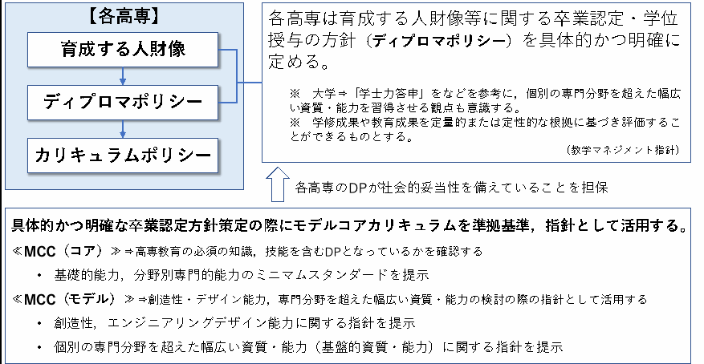
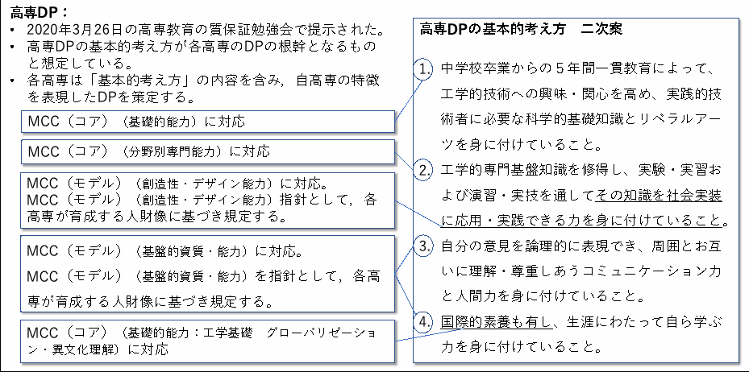

## 3-2 各高専のディプロマポリシーの策定とMCCとの関係

各高専はそれぞれが設定する育成する人財像等に関するディプロマポリシーを具体的かつ明確に定めることが求められる。「教学マネジメント指針」[20]は以下のように示す。

「何ができるようになるか」に力点を置き、どのような学修成果を上げれば卒業を認定し、学位を授与するのかという方針をできる限り具体的に示すこと。その際、学士課程答申で示された「各専攻分野を通じて培う学士力～学士課程共通の学習成果に関する参考指針～」を踏まえるとともに、日本学術会議の「大学教育の分野別質保証のための教育課程編成上の参照基準」（以下「分野別参照基準」という。）等も参考とすることが考えられること （教学マネジメント指針、p.12）また、「卒業認定・学位授与の方針」の策定に当たっては、大学全体の教育理念等との整合性を意識する必要があるとともに、前述の「各専攻分野を通じて培う学士力～学士課程共通の学習成果に関する参考指針

～」等を踏まえ、個別の専門分野を超えた幅広い資質・能力を修得させるという観点も意識することが期待される。 （教学マネジメント指針、pp.13-14）国立高専ではMCCが各高専のディプロマポリシー設定の際の基盤となる。MCC(コア)は習得すべき知識・技能を示しており、MCC(モデル)は「教学マネジメント指針」において大学等が踏まえるべき「学士力答申」及び「分野別参照基準」で示された個別の専門分野を超えた幅広い資質・能力に対応する内容として整理されている（図7）。各高専がMCCを包含するディプロマポリシーを設定することにより、最低限要求される能力を備えていることが担保されることとなる。

（図の書き起こし: [fig-031-1.md](../figures/fig-031-1.md)、mcc2023:doc:034）

図7 各高専のディプロマポリシーとMCCとの関係

「教学マネジメント指針」を踏まえ、各高専でのディプロマポリシーの見直しを支援、促進するために、令和 2（2020）年3月に国立高専機構は全国高専が参照すべき「高専DP の基本的な考え方」を提示した。各高専のディプロマポリシーは「高専 DP の基本的な考え方」を包含し、それぞれの特色を反映させたものとして設定されることが求められている。「高専DPの基本的な考え方」はMCCに準拠したものであり（図8）、これを含む各高専のディプロマポリシーはMCCを包含するものである。

（図の書き起こし: [fig-032-1.md](../figures/fig-032-1.md)、mcc2023:doc:035）

図8 高専DPの基本的考え方とMCCとの対応

また、各高専はそれぞれの地域性、歴史、専門性などを踏まえた上で、社会の多様なニーズに応えるために、育成する人財像を定め、それを具体的にしたディプロマポリシーを策定する。したがって、各高専のディプロマポリシーは MCC を包含した上で、各高専の特色を反映させた内容となる。また、社会や産業構造の転換を実現するために必要とされる分野で高専全体として教育の高度化を図っている内容については、国立高専機構の様々な事業、たとえば COMPASS 5.0やGEAR 5.0などの事業成果なども踏まえた上で検討することが望まれる（なお、これらの事業で検討された成果物の一部である到達目標群についてはMCC plus※として第3部に提示する）。

※MCC plusについて

モデルコアカリキュラムは高専教育におけるミニマムスタンダードを整理したものである。当然のこ

とながら高専教育はモデルコアカリキュラムに限定されるものではなく、各高専がそれぞれの特色を活

かしつつ、社会ニーズに応えて教育の高度化を目指すものと考えている。このような高専教育の高度化

あるいは各高専の特色の伸長、深化を図る際の指針として提示される到達目標がMCC plusである。
