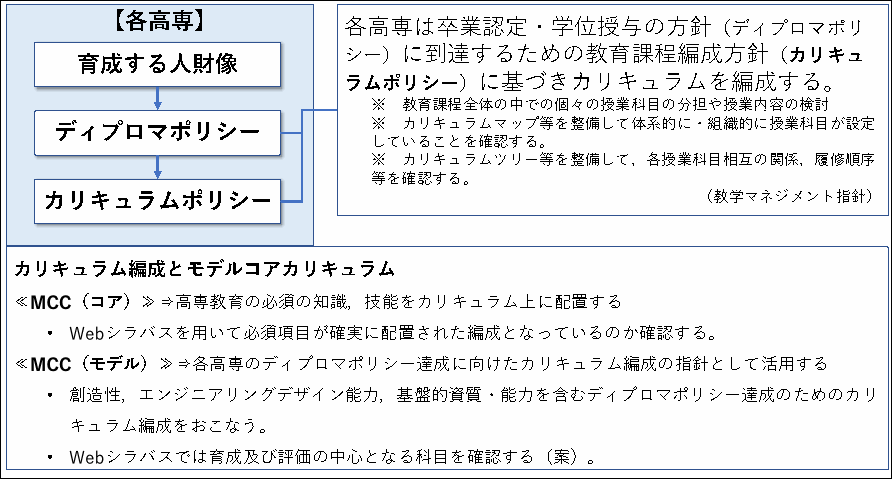

### 3-3.1 各高専のカリキュラムにおけるMCC到達目標の達成に向けた学習機会の保証

各高専が保証すべき、それぞれのディプロマポリシーに包含される MCC の到達目標達成のための学習機会の保証、すなわちカリキュラムの設計について以下の点に留意する必要がある。MCC(コア)は分野共通の基礎的能力、分野別専門的能力から構成されている。分野共通の基礎的能力は主に一般科目が対応する学習領域の到達目標が整理されており、分野別専門的能力は主に専門科目が対応する学習領域の到達目標が整理されている。ただし、これらの対応関係は必ずしも固定的なものではなく、MCC(コア)に含まれる到達目標は各高専のカリキュラム全体を通して達成されるものと考えている。したがって、分野共通の基礎的能力に挙げられている到達目標を専門科目で達成すること、逆に分野別専門的能力に挙げられている到達目標を一般科目で達成するようにカリキュラムを編成することも可能である。

また、MCC(モデル)については、一般的な科目との一対一の対応関係を前提とすることは困難であると考えられるため、カリキュラム全体を通して、また様々な科目の中で育成が試みられ、学習成果の評価を行うものと想定している。各高専（あるいは各学科）は、MCC(モデル)に含まれる到達目標が含まれたディプロマポリシーを策定することとなる。そのため、各高専（あるいは各学科）は、MCC(モデル)の到達目標を含むディプロマポリシー達成のために、体系的な学習機会の整備を行うこととなる。各高専はこれらの達成のために、どのような科目を、どのような順番で配置し、また、学習成果をどのタイミングで、どのような方法、基準によって把握するのかという点についても検討する必要がある。MCC(モデル)：基盤的資質・能力に含まれる汎用的技能や態度・志向性に関して、課外活動や学生寮での生活などを通した学習経験による影響も大きいと考えられるため、それらをカリキュラムの中にどのように取り込むのかという点についても考慮することが望まれる。

また、MCC(モデル)：創造性・デザイン能力については、高専教育の特長、強みであるPBLなどの問題解決、課題達成を通して育成するとともに、こうした学習活動を通して各高専が定める専門分野の能力がレベル4（実践）に到達するものと想定している。したがって、各高専はカリキュラムを編成するにあたり、習得した知識・技能、あるいは分野に関わらず必要とされる汎用的技能、さらに様々な活動の基盤となる態度・志向性などを発揮して、試行錯誤しながら問題解決、課題達成を図る学習機会を保障することが不可欠となる。たとえば地域社会と連携した具体的な問題解決を図る PBL、企業等と連携した COOP 教育の導入など、創造性やエンジニアリングデザイン能力の育成を目的とした学習機会を保証することが求められる。

各高専におけるカリキュラムポリシーに基づくカリキュラム編成と MCC との関係について図9 に示す。なお、MCC(モデル)の到達目標を含むカリキュラム編成及び科目設計については、各高専での実践事例を含む参考資料を第 4 部に提示する予定である。資料を参照した上で、各高専のディプロマポリシー達成に向けたカリキュラム編成及び各科目の授業設計を行う必要がある。

（図の書き起こし: [fig-034-1.md](../figures/fig-034-1.md)、mcc2023:doc:038）

図9 各高専のカリキュラムポリシー及びカリキュラム編成とMCCとの関係
