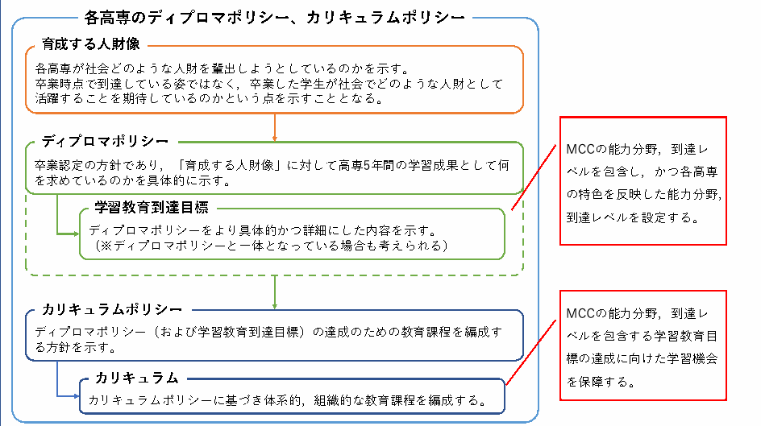

### 3-3.3 単独学科等と複合融合学科等へのMCCの適用にあたっての考え方

社会の様々な課題に対応する技術者を養成するために、複数の専門分野の知識・技能の習得をディプロマポリシーに掲げる高専が存在し、また、今後も増加することが予想される。そこで、単独の専門分野から構成される学科/コース（以下、「単独学科/コース」という。）及び複数の専門分野から構成される学科/コース（以下、「複合融合学科/コース」という。）へMCCを適用する場合の指針を定めている。

単独学科/コース

単独学科/コースの場合は、カリキュラムの中に該当するMCC(コア)分野別専門的能力に含まれる到達目標をすべて包含することが求められる。

複合融合学科/コース

以下に示す「複合融合学科/コースへの適用指針」に基づき「複合融合学科/コースへの配慮事項」を整理している。複合融合学科/コースの場合、その学科/コースを構成する分野について「複合融合学科/コースへの配慮事項」に含まれる到達目標をカリキュラムの中に包含することが求められる。

#### 複合融合学科/コースへの適用指針

（１） 基本方針

各高専においてディプロマポリシーに掲げる人財育成を教学マネジメントに則して実現するため、専門分野の壁を越えた総合的な問題解決能力の育成を図る複合融合型のカリキュラム設計を可能とするために、個別の専門分野のMCC(コア)の単なる積み上げとならないよう、各分野の必須項目の内容や分量等をさらに精選し、「複合融合学科/コースへの配配慮事項」として定める。

なお、複合融合学科/コースがMCC(コア)を充足しているか否かを判断する際、2分野の複合融合を基本とする。3分野以上にまたがる場合は、そのうちの中核となる2分野でMCC(コア)を満たすカリキュラムを編成する。残る分野は「各高専の特色」としてMCC(コア)の充足を要しない。

（２） 複合融合学科/コースへの配慮事項の考え方

複合融合学科/コースが2つの専門工学Ａ、Ｂから構成される場合を考える。ここで、各々の到達目標群の全項目数をNA、NBとし、専門工学Ａの到達目標群からの選択項目数をnA個、及び専門工学Ｂの到達目標群からの選択項目数を nB個とする。このとき、各高専の複合融合学科/コースでは、設定されたディプロマポリシーに応じて、

𝑛𝐴

𝑛𝐵

+

≧1

𝑁𝐴 𝑁𝐵

を満たすように到達目標を選択することとする。ここで重要なことは、複合融合学科/コースにおいても、単独学科と同程度の分量のコア修得と、専門工学の横断的な能力（俯瞰的視野、問題解決力等）の修得を同時に実現しうる点にある。

このような考え方に立ち、複合融合学科/コースへの配慮事項を整理している（「第 2 部 高専教育におけるミニマムスタンダードとしての到達目標」を参照）。

ここまで述べた各高専の各高専のディプロマポリシー、その達成に向けたカリキュラムポリシー及びカリキュラムMCCとの関係を改めて示すと以下のようになる（図10）。

（図の書き起こし: [fig-036-1.md](../figures/fig-036-1.md)、mcc2023:doc:041）

図10 各高専のディプロマポリシー、カリキュラムポリシー及びカリキュラムとMCCとの関係
