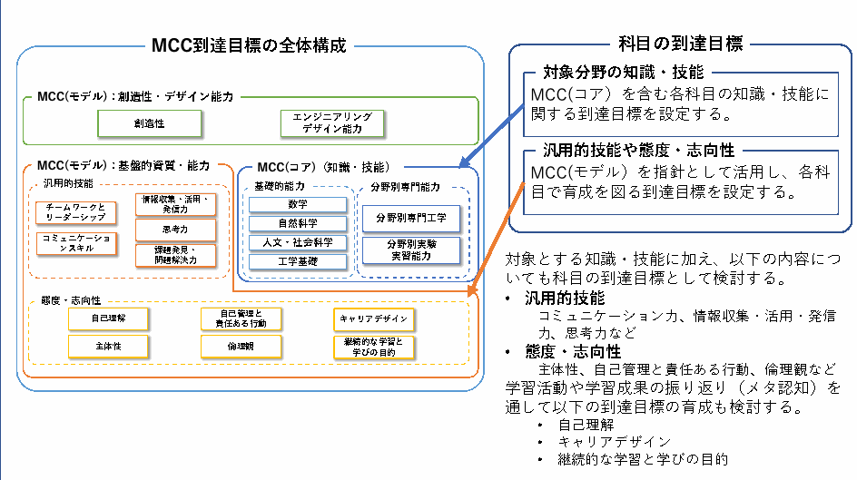

### 3-4.1 MCC(コア)とMCC(モデル)を組み合わせた授業設計の考え方：講義系科目など

一般科目、専門科目は主としてMCC(コア)の分野共通の基礎的能力、分野別専門的能力に挙げられている到達目標を含む学習目標を設定し授業計画を立てることとなる。ただし、分野共通の基礎的能力及び分野別専門的能力は主に知識・技能を中心に到達目標を整理している点に留意する必要がある。各科目で育成する能力はそれぞれの分野の知識・技能に限定されず、汎用的技能や態度・志向性に関わる資質・能力の育成も図るものと考えられる。そこで各科目の授業計画（シラバス）を作成するにあたり、MCC(コア)とMCC(モデル)を組み合わせた学習目標を設定し、その育成に必要な学習活動、教育的介入方法を検討するとともに、学習成果を測定・評価する基準・方法を検討することとなる（図11）。なお、MCCでは講義系科目などを通してカリキュラム全体として、分野共通の基礎的能力及び分野別専門的能力についてレベル3（適用）まで到達することを想定している（なお、分野別専門的能力の到達レベル4（実践）については次項で言及する）。

（図の書き起こし: [fig-037-1.md](../figures/fig-037-1.md)、mcc2023:doc:044）

図11 一般科目、専門科目の講義系科目の授業設計とMCC(コア)、MCC(モデル)の関係

【付記】

「高等学校学習指導要領（平成30年告示版）」[23]でも、以下のように、学力の3要素を組み合わせたカリキュラム設計、授業設計が求められている。高専教育は必ずしも高等学校教育と一致するわけではないが、中等教育後期課程を含む5年間の教育課程であることを踏まえ、参考にすることは有用である。

また令和4年度から上記指導要領が全面適用されているが、「総合的な探究」や「地理総合」「歴史総合」「地理探究」「日本史探究」「世界史探究」「古典探究」「理数探求基礎」「理数探究」及び「総合的な探究」などの内容も参考としながら、高専においても各科目の授業設計を検討することが重要である。

「高等学校学習指導要領（平成30年告示版）」第1章総則第1款（抜粋）

3 ……学校教育全体及び各教科・科目等の指導を通してどのような資質・能力の育成を目指すのかを明確にしながら、教育活動の充実を図るものとする。その際、生徒の発達の段階や特性等を踏まえつつ、次に掲げることが偏りなく実現できるようにするものとする。

（1）知識及び技能が習得されるようにすること。

（2）思考力、判断力、表現力等を育成すること。

（3）学びに向かう力、人間性等を涵養すること。
