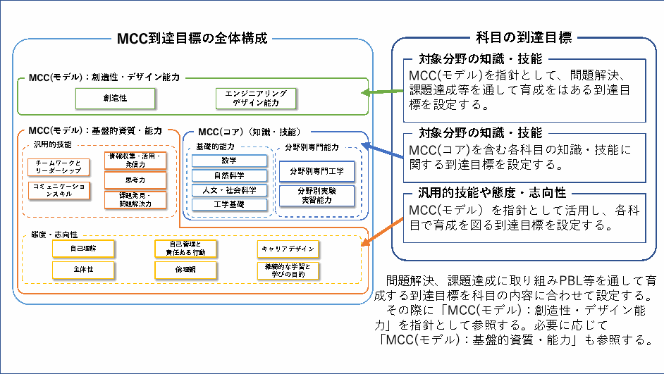
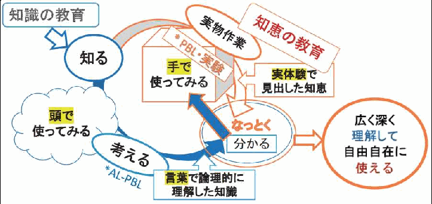
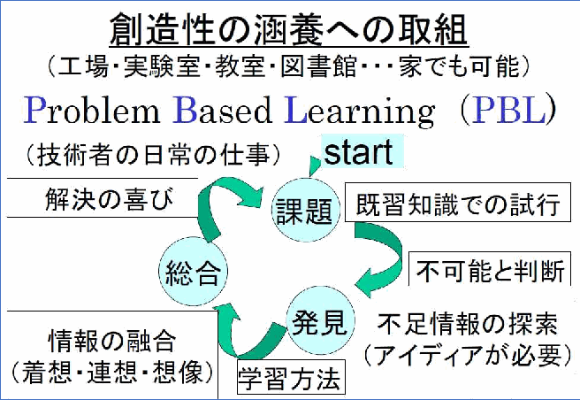

### 3-4.2 MCC(コア)とMCC(モデル)を組み合わせた授業設計の考え方：PBL、社会実装教育など

MCCでは一般科目や専門科目を通して習得した知識・技能、汎用的技能及び態度・志向性を活用し、具体的な問題解決、課題達成を図る学習活動を通して、特に専門的能力についてレベル 4（実践）まで到達するものと想定している。こうした学習活動によって達成される到達目標を設定する際の指針として位置づけられるのが「MCC(モデル)：創造性・デザイン能力」である。

複合的な要素から構成される具体的な状況を分析し、問題を特定するあるいは課題を設定する能力、問題解決や課題達成に関わるステークホルダーを考慮した上で解をデザインする能力、さらに解を実現するためのプロセスを計画した上でその進捗を管理する能力など多岐にわたる能力の開発は、いわゆるPBLや社会実装教育などを通して行われるものと考えられる。高専教育の強みは知識と実践を組み合わせた学びにあり、習得した知識・技能、汎用的技能、態度・志向性を発揮しながら、具体的な問題解決・課題達成に向けた学習活動を通して実践的技術者に求められる創造性やデザイン能力の育成をカリキュラム全体で達成するよう、各高専の特色を活かしたカリキュラム編成及び授業設計を行うことが求められる（図12）。

（図の書き起こし: [fig-038-1.md](../figures/fig-038-1.md)、mcc2023:doc:046）

図12 問題解決・課題達成を図る授業設計とMCC(コア)、MCC(モデル)の関係

#### 【創造性育成に向けた教育の考え方】

創造性の育成に向けた教育のあり方についてはさまざまな考え方があり、また、各高専でもこれまで様々な方法が試行錯誤され、実践されている。人々や社会の課題を認知、把握し、問題解決、課題達成を実現する解の創造は、決して定型的な方法によっては行われないものと考えられる。それゆえ創造性育成に向けた教育は、知識の習得のみによって行われるものではなく、また、思考方法の理解、応用によって行われるものではない。創造は試行錯誤、挑戦と失敗の過程の中で生じる気づき、着想によって初めて行われるものであると考えられる。それゆえ各高専のカリキュラム編成、授業設計にあたっては、学生が現実の問題に向き合い、自ら課題を設定し、習得した知識、技術を駆使して試行錯誤を繰り返すという学習経験が重要である。こうした教育は「知恵の教育」ということもできる（図13）[24]。

（図の書き起こし: [fig-039-1.md](../figures/fig-039-1.md)、mcc2023:doc:047）

図13 知識と知恵の教育

（四ツ柳隆夫、科学を使いこなす知恵の教育、J. of JSEE、70-3（2022）より引用）高専教育ではこのような考え方の教育をこれまで実践してきている。問題解決や課題達成を目指したPBLや具体的な社会課題解決に向けた社会実装型PBL、企業等との協働による教育

（COOP教育）などでは技術者が実際に問題解決、課題達成に向けて行う業務の体験を通して学生は学びを深めていく。習得した知識、技術を応用し、それらだけでは対応できないということを実感したうえで、自ら収集、分析した知識や情報の収集とともに試行錯誤の中で得られる着想を問題解決、課題達成に向けて総合的に活用していくのである（図14）[25]。

（図の書き起こし: [fig-039-2.md](../figures/fig-039-2.md)、mcc2023:doc:048）

図14 創造性涵養の取組み

（四ツ柳隆夫、中央教育審議会大学分科会制度部会資料、2004.6.17より引用）MCC(モデル)の到達目標の充足とともに、このような考え方を参考にしながら、各高専において創造性、デザイン能力育成に向けたカリキュラム編成、授業設計を検討いただきたい。
