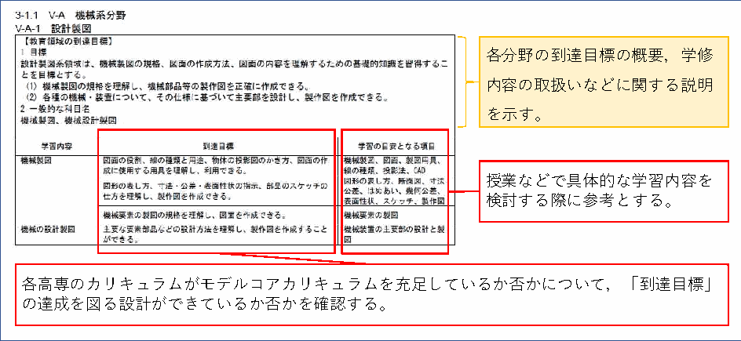

## 1-2 様式2：MCC(コア)分野別専門的能力及び工学基礎

工学基礎、分野別専門的能力は様式2を用いて到達目標を整理している（図2）。

（図の書き起こし: [fig-047-2.md](../figures/fig-047-2.md)、mcc2023:doc:062）

図2 様式2 MCC(コア)分野別専門的能力及び工学基礎用

なお、様式2における「学習の目安となる項目」は令和5（2023）年度版MCCの検討にあたり追加された。令和3～4年度にかけて行った改訂検討にあたり、細部にわたって到達目標を設定していた分野においてカリキュラム編成の自律性が低下する問題を解消するために、平成29年度版MCCの到達目標の構造を分析、整理し、令和5年度版MCCでは抽象度を上げた到達目標を設定している。一方で重要項目が欠落することのないように、また、従前のCBT作問方針との一貫性を保つために「学習の目安となる項目」を付記している。

各高専がカリキュラムを編成するにあたり、MCC到達目標との対応関係を確認することが求められるが、「学習の目安となる項目」については具体的な授業計画の検討の際に参考指針として活用していただくことを想定している。
