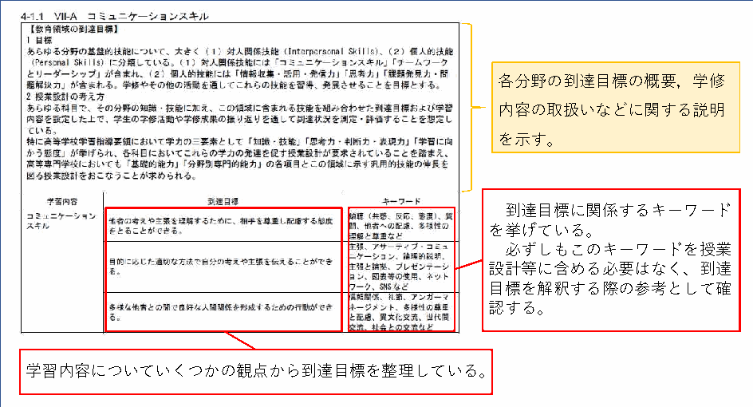

## 1-3 様式3： MCC(モデル)

MCC(モデル)は様式3を用いて到達目標を整理している（図3）。工学基礎、分野別専門的能力と同様に、平成29年度版MCCの到達目標の構造を分析した上で令和5年版MCCの到達目標を整理している。ただし、MCC(モデル)に含まれる資質、能力は様々な観点から整理され、その構成についても論者によって異なる。したがって、工学基礎、分野別専門的能力の到達目標に併記される「学習の目安となる項目」と異なり、「キーワード」を記載している。「キーワード」には当該到達目標（あるいはそれらが含まれる学習内容）に関する議論等の中で言及されるキーワードを挙げている。各高専でカリキュラム編成あるいは授業設計を行う際には、必ずしもこれらのキーワードを包含する必要はなく、参考としていただきたい。

（図の書き起こし: [fig-048-1.md](../figures/fig-048-1.md)、mcc2023:doc:064）

図3 様式3 MCC(モデル)用
