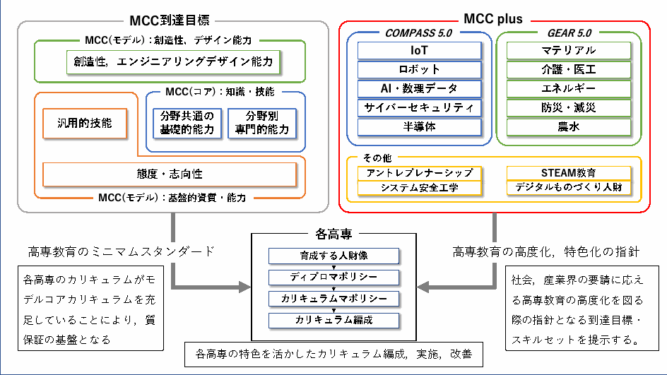

# 第1章 高専教育の高度化、特色化とMCC及びMCC plus

MCCは国立高専教育におけるミニマムスタンダードを明確にし、各高専のカリキュラムに包含されることにより、教育の質保証を担保する役割を担う。しかし各高専の教育はMCCに限定されるのではなく、それぞれの特色や強みを活かしながら育成する人財像を定め、それを具体化したディプロマポリシーを設定したうえで、その達成に向けて自律的にカリキュラム編成を行うこととなる。その際、地域社会や産業界などのニーズに応え、今後の社会や産業をけん引する人材を育成するために、各高専がその教育内容を高度化するための取り組みを行うことが必要となる。国立高専機構はそのスケールメリットを活かして高専教育の高度化、特色化を支援、促進するさまざまな事業を展開しており、各高専はこれらの事業の成果を活用することにより教育の高度化、特色化を推進することが可能である。

令和5年公開のMCCでは、各高専の特色ある教育の伸長、深化を支援、促進するために、高専教育のミニマムスタンダードと位置づけられるMCC到達目標と併せて、国立高専機構が検討、実施しているさまざまな事業成果を踏まえた到達目標群をMCC plusとして提示することとした（図1）。下図に示すMCC plusの学習領域は例示であり、確定しているものではない。MCC plusにはその時々で社会や産業界が必要とする多様な分野について、国立高専として教育内容、手法を検討、共有を図るものが適宜含まれることとなる。

（図の書き起こし: [fig-153-1.md](../figures/fig-153-1.md)、mcc2023:doc:071）

図1 MCC到達目標とMCC plus
