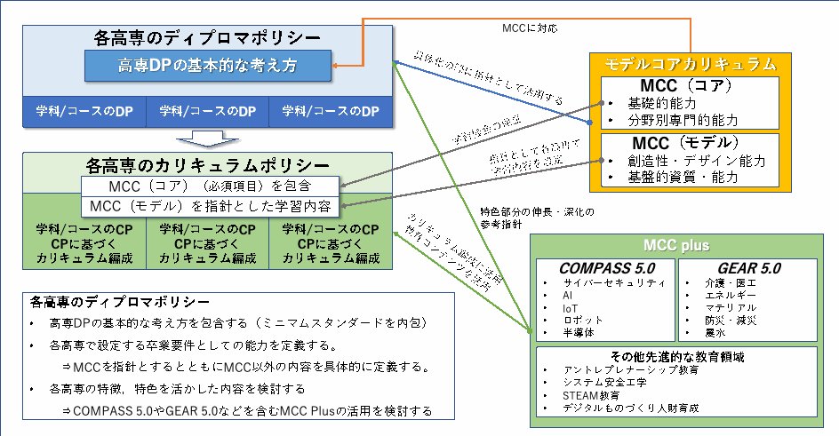

## 1-1 各高専のカリキュラムマネジメントとMCC及びMCC plusの関係

MCCが国立高専教育のミニマムスタンダード、すなわち必須となる学習内容および到達水準を定めているのに対して、MCC plusは各高専が積極的に導入することが期待される学習内容及び到達水準、すなわち社会や産業界が期待する人財として身に付けておくべき知識や能力を整理し到達目標である。したがって、カリキュラム編成を行う際に、MCC plusに示される内容を包含することを各高専が要求されるわけではない。ただし、各高専がMCCに規定されるミニマムスタンダードとしての学習内容及び到達水準に留まらず、それぞれの特色を活かしたカリキュラム編成を行うにあたり、MCC plusを参考指針として活用することを期待している。

なお、MCC到達目標は高専教育のミニマムスタンダードを定めたものであり、各高専のカリキュラム編成の際の指針として一定期間参照される基準として機能するため、概ね5年ごとに改訂検討を行うものと予定されている。これに対してMCC plusに含まれる学習内容は、社会的状況の変化や学問の発展動向などの必要に応じて検討され、整理される。それゆえ一定期間通用する基盤として運用されるMCCを補完する役割をMCC plusが担うこともある。また、MCC plusに含まれる学習内容が、MCCの改訂検討に活かされることもある。

第1部に示したように、各高専のディプロマポリシーは、育成する人財像を具体化したものとして、MCC到達目標を包含したうえでそれぞれの特色を活かして設定される。各高専の特色部分はそれぞれの地域性や歴史、専門性などを反映させたものと考えられるが、併せて多様化、複雑化する社会的要請や産業界のニーズに応えながら教育の高度化を図るものである。そのために、国立高専のスケールメリットを活かした事業成果を活用して各高専の教育内容の高度化を検討することが望まれる。国立高専のさまざまな事業では、産業界と連携しながら、社会的に期待される人材として身に付けるべき知識、能力を整理し、また、それらを習得させるために有効な教材の開発、あるいは教育方法等を開発、共有している。これらを活用することにより、各高専の教育の高度化とともに、国立高専全体の教育水準を向上させることを国立高専機構は目指しているのである（図2）。

（図の書き起こし: [fig-154-1.md](../figures/fig-154-1.md)、mcc2023:doc:073）

図2 各高専のディプロマポリシー、カリキュラムポリシーとMCC、MCC plusの関係
