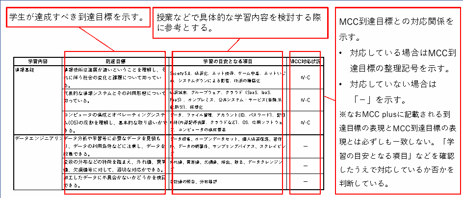

## 2-2 MCC plus 2023：次世代基盤技術分野における到達目標（スキルセット）

MCC plusとして提示する到達目標群（スキルセット）はMCC(コア)分野別専門的能力と同様の様式で提示する。MCC plus 2023はCOMPASS 5.0の4分野（AI・数理データサイエンス、サイバーセキュリティ、ロボット、IoT）で整理された到達目標群となる。それぞれの分野において、関連する産業分野のニーズなどを把握したうえで「育成する人財像」を定め、その人財に求められる資質、能力を整理している。各分野の到達目標群にはMCC到達目標に含まれるものもある。各分野で育成する人財像の全体が理解できるように、MCC到達目標に含まれている内容も含めて提示する（図3）。

（図の書き起こし: [fig-157-1.md](../figures/fig-157-1.md)、mcc2023:doc:078）

図3 MCC plusの記載様式
